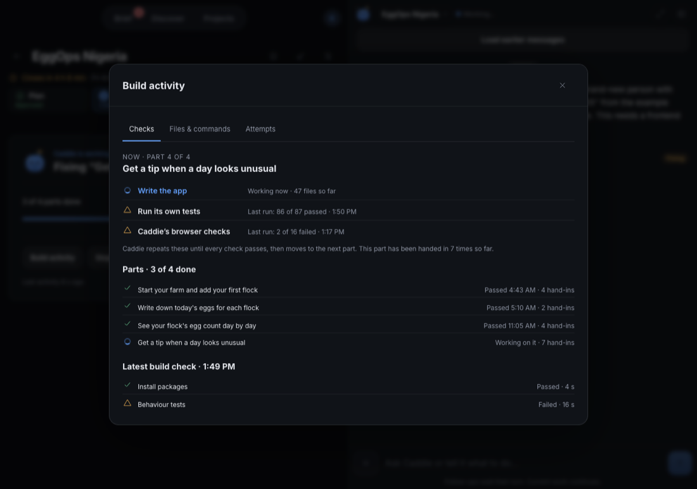
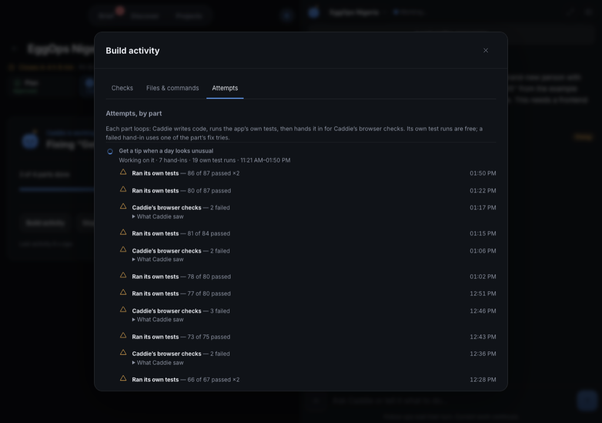
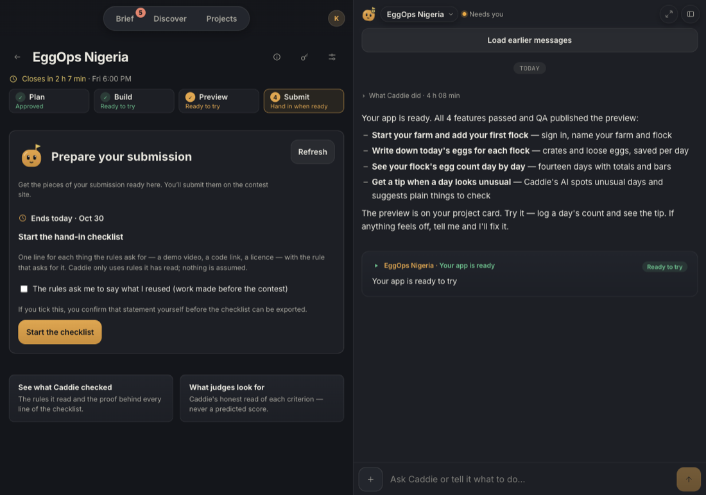

# Caddie

Caddie is an evidence-backed build assistant for non-technical owners: it
**finds** open hackathons from live sources, **plans** a project against the
contest's real rules, **builds** it through restricted AI specialists in an
isolated sandbox, **proves** every part with checks it runs itself in a real
browser, and **prepares** the hand-in list — then stops and lets the human
press Submit.

**Built on Nebius Token Factory and NVIDIA Nemotron.** Every model call goes
through Nebius Token Factory's OpenAI-compatible API, and the generated code is
installed, built and tested in Token Factory sandboxes. NVIDIA Nemotron runs
Caddie's conversation, idea brainstorming, architecture review, rules reading,
hackathon ranking and summaries, image understanding, and the AI inside every
app Caddie builds: four Nemotron models in all (Ultra, Super-VL, Lightning
and Nano) — see [Nebius Token Factory and NVIDIA
Nemotron](#nebius-token-factory-and-nvidia-nemotron).

The product itself is hosted as one Cloudflare Worker (Flue 2.2.2 agents on
Durable Objects, D1, a React app under `/app`, and the landing page at `/`).

Evidence labels used throughout this file follow the project's rule:
**LOCAL VERIFIED**, **LIVE VERIFIED**, **SIMULATED**, **DOCUMENTATION ONLY**,
**BLOCKED**, **FAILED**. A mocked or local-only pass is never LIVE VERIFIED, and
a model's own account of its work is never evidence.

---

## What Caddie is

The loop is Find → Plan → Build → Prove → Ship.

| Stage | What Caddie does | Where it lives |
| :--- | :--- | :--- |
| **Find** | Reads live opportunity sources (Devpost's API plus Tavily web search), filters to open events, and ranks fit with the claims it rests on. A failed retrieval shows as a visible gap, never a confident guess. | `apps/app/src/server/discovery.ts`, `apps/app/src/server/tavily.ts` |
| **Plan** | Turns a chosen contest's rules page into an immutable snapshot and verbatim, line-cited claims; produces a versioned scope, PRD and spec, and binds approval to the exact revision. You then pick a look for the app. | `apps/app/src/server/rules-reading.ts`, `apps/app/src/server/planning.ts`, `apps/app/src/server/build-workflow.ts` |
| **Build** | A coordinator delegates to restricted specialists (product, designer, tech-lead, frontend, backend, mobile, QA) that write code in an isolated sandbox. Permissions are per-role; destructive and default-branch actions always need explicit approval. | `apps/app/src/agents/coordinator.ts`, `apps/app/src/agents/specialists.ts`, `apps/app/src/agents/permissions.ts` |
| **Prove** | The host — not the model — runs the checks: install, `bun test src/`, build the browser bundle, the runs-on-Cloudflare check for apps with a server, and each part's own checks in a real browser on a brand-new account. Receipts are recorded per check. | `apps/app/src/server/coordinator-host.ts`, `apps/app/src/server/preview-runtime.ts`, `apps/app/src/server/independent-acceptance.ts` |
| **Ship** | Prepares the hand-in list from the contest's own rules, with missing items shown as missing, and a publish path to a Cloudflare-hosted app (publishing is not deployed yet). Caddie never submits for you. | `apps/app/src/server/judge.ts`, `apps/app/src/server/submission.ts`, `apps/app/src/server/publish.ts` |

### Screenshots

Real captures from the **EggOps Nigeria** build of 2026-10-30 (an egg-farm app
for Nigerian poultry farmers, planned, designed, built in 4 parts and checked
end to end by Caddie). **LOCAL VERIFIED**: Caddie ran on this machine; its
models and sandbox were the real Nebius Token Factory services.

| | |
| :--- | :--- |
|  |  |
| Build → Checks: the current part, its write → own tests → Caddie's browser checks loop, every part's state | Build → Attempts: every round, grouped by part, in plain words |
|  | |
| Submit: what you'll hand in, from the contest's own rules | |

The landing page (`apps/site/public/shots/`) uses captures from the same run.

---

## For judges

### Demo URL

**`https://caddie.jamalibrahim.dev`.** Redeployed on 2026-10-30 on a fresh
database (see the status table for the smoke result). You can also run Caddie
[locally](#run-it-locally).

### Getting in

- **One shared judge account.** Its judge name and password are in the
  **Devpost testing instructions**, never in this repository.
- On the sign-in page choose **"Judging the hackathon? Sign in here"** and
  enter that name and password. No Google or GitHub account and no email are
  needed.
- The app built in the demo video is already under **Projects**: open it, try
  the preview, or ask Caddie for a change. You can also start a new app of your
  own from an idea.
- The account is shared by every judge, so you may see other judges' projects.
  It cannot publish apps.
- **Two fresh judge accounts** (also in the testing instructions) have never
  been signed in, so they show Caddie's first-time setup from the very first
  screen. Each account has its own limits.

### Limits on the shared account (plain words)

So one judge cannot use up the demo for the others, the shared account has, per
rolling 24 hours: **30 build starts**, **1,000 Caddie messages** and **60 live
hackathon searches**, and at most **20 projects**. A build starts when the
design is approved; retrying a stopped build is another start. Model spending
is also capped at **$30 a day** and **$15 per project**. These are the
deployment's settings (`JUDGE_MAX_*`, `MODEL_SPEND_*`), enforced server-side in
`apps/app/src/server/judge-limits.ts` and
`apps/app/src/server/model-spend-guard.ts` (**LOCAL VERIFIED** in
`tests/judge-limits.test.ts` and `tests/model-spend-guard.test.ts`).

### A two-minute path to try

1. Sign in as above (~20 seconds).
2. Open **Projects** → the demo app. **Preview** runs the real app; it signs in
   with an emailed code, and the code arrives in the **test inbox** on the
   Build tab (built apps don't send real email yet).
3. **Build → Build activity** shows how each part was checked: the app's own
   tests, then Caddie's browser checks on a brand-new account.
4. Ask Caddie for an idea, or open **Discover** for live hackathons with their
   cited rules. Ask Caddie to plan a small app (at most 3 parts), approve the
   plan, pick a look, and the build starts. A build takes about an hour.

You are looking for one thing above all: **every claim has a receipt**, and
when something cannot be checked, Caddie says so instead of guessing.

---

## Nebius Token Factory and NVIDIA Nemotron

**Everything Caddie thinks with, and everywhere its code runs, is on Nebius
Token Factory.** Every model call goes to Token Factory's OpenAI-compatible
endpoint (`https://api.tokenfactory.nebius.com/v1`), and the sandbox where
generated code is installed, built and tested is Token Factory's sandbox API
(`https://api.tokenfactory.nebius.com/sandboxes`) on the same account.

**What NVIDIA Nemotron does in Caddie.** Nemotron is the part of Caddie you
talk to and the part your app talks with. **Nemotron 3.5 Super VL** holds the
conversation and understands images you attach. **Nemotron 3 Ultra**
brainstorms what to build with you and reviews the architecture of big apps.
**Nemotron 3 Nano** reads contest rules into cited claims, ranks hackathons
and writes their summaries. And the AI inside every app Caddie builds runs on
**Nemotron 3.5 Lightning** (fast) or **Nemotron 3.5 Super VL** (when the app
asks for the deeper tier). Writing the plan, the looks and the code goes to
other open models on the same Token Factory account (DeepSeek, GLM, MiniMax),
picked from measured runs.

**Role → route → model id**, as it is in the code today
(`apps/app/src/agents/providers.ts`: `MODEL_ROLES`, `MODEL_ROUTES`). The model
ids are the exact, case-sensitive Nebius listing spellings (`Nemotron-3.5-…`
with a dot, `Nemotron-3_5-Lightning` with an underscore).

| Role | What it does | Route id | Nebius model id | Call site |
| :--- | :--- | :--- | :--- | :--- |
| `chat` | Caddie's conversation (the coordinator) | `nemotron-3.5-super-vl` | `nvidia/Nemotron-3.5-Super-VL` | `apps/app/src/agents/coordinator.ts` (`coordinatorModelSelection`) |
| `ideation` | Brainstorming what to build (Home) | `nemotron-3-ultra` | `nvidia/Nemotron-3-Ultra-550b-a55b` | `apps/app/src/agents/coordinator.ts` (`coordinatorModelSelection` → `ideation`) |
| `architect` | Architecture review of big apps (team mode) | `nemotron-3-ultra` | `nvidia/Nemotron-3-Ultra-550b-a55b` | `apps/app/src/agents/specialists.ts` (architect delegate, `findModelRouteForRole('architect')`) |
| `vision` | Understanding attached images | `nemotron-3.5-super-vl` | `nvidia/Nemotron-3.5-Super-VL` | `apps/app/src/server/attachments.ts` (`MODEL_ROLES.vision`) |
| `helperRules` | Reading contest rules into cited claims | `nemotron-3-nano` | `nvidia/NVIDIA-Nemotron-3-Nano-30B-A3B` | `apps/app/src/server/rules-reading.ts` |
| `helperRanking` | Ranking hackathon fit | `nemotron-3-nano` | `nvidia/NVIDIA-Nemotron-3-Nano-30B-A3B` | `apps/app/src/server/candidate-inspection.ts` |
| `helperSummary` | Hackathon summaries | `nemotron-3-nano` | `nvidia/NVIDIA-Nemotron-3-Nano-30B-A3B` | `apps/app/src/server/candidate-inspection.ts` |
| `helper` | Other small helper calls | `nemotron-3-nano` | `nvidia/NVIDIA-Nemotron-3-Nano-30B-A3B` | `apps/app/src/agents/hello.ts` |
| `app` | AI inside generated apps (fast tier) | `nemotron-3.5-lightning` | `nvidia/Nemotron-3_5-Lightning` | `apps/app/src/server/app-ai.ts` |
| `appSuper` | AI inside generated apps (deeper tier, `tier: "super"`) | `nemotron-3.5-super-vl` | `nvidia/Nemotron-3.5-Super-VL` | `apps/app/src/server/app-ai.ts` |
| `planAuthor` | Writing the plan (product and tech-lead) | `deepseek-v4.1-flash-1017` | `deepseek-ai/DeepSeek-V4.1-Flash-1017` | `apps/app/src/agents/specialists.ts` (`specialistModelRole`), `apps/app/src/server/build-workflow.ts` |
| `planReviewer` | Independent review of the plan | `glm-5.3` | `zai-org/GLM-5.3` | `apps/app/src/server/artifact-quality.ts` (plan review ladder starts on `glm-5.3`; the author's model family never reviews) |
| `designAuthor` | Writing the looks and screens (designer) | `minimax-m3.1-flash` | `MiniMaxAI/MiniMax-M3.1-Flash` | `apps/app/src/agents/specialists.ts` (`specialistModelRole`), `apps/app/src/server/coordinator-host.ts` |
| `build` | Writing code and its tests (frontend, backend, mobile, QA) | `minimax-m3.1-flash` | `MiniMaxAI/MiniMax-M3.1-Flash` | `apps/app/src/agents/specialists.ts` (`specialistModelRole`); a build's model is the first rung of the repair ladder below |
| `plan` | Older planning route, kept so earlier runs still resolve | `glm-5.3-flash` | `zai-org/GLM-5.3-Flash` | `apps/app/src/agents/specialists.ts` (planning-skill fallback only) |

**The repair ladder** (`apps/app/src/server/repair-escalation.ts`). Two failed
checks on the same issue move it one rung: `REPAIR_ROUTES` =
`minimax-m3.1-flash` → `deepseek-v4.1-flash-1017` →
`deepseek-v4.1-flash-1017`. An issue that needs to see an image repairs on
routes that read images: `VISION_REPAIR_ROUTES` = `nemotron-3.5-super-vl` →
`deepseek-v4.1-flash-1017`. When the ladder runs out, the build pauses and asks
you. The 2026-10-30 EggOps run is why the last code rung is DeepSeek, not Super
VL (the notes are on `REPAIR_ROUTES`).

**Prices.** Each route carries the price list it was priced from, and a run
binding records the route and pricing it started under, so a re-price never
rewrites an old run. The Nemotron routes and GLM-5.3-Flash carry
`PRICING_VERSION = '2026-10-nemotron-listing'` (re-read from a live
`GET /v1/models?verbose=true` listing on 2026-10-18); DeepSeek and GLM-5.3
carry `'2026-10-25-repair-catalog'`, and MiniMax `'2026-10-27-nebius-catalog'`.

**Images.** `VISION_ROUTE_IDS` lists the routes that demonstrably read an image
and returned a tool call: `nemotron-3.5-super-vl` and `glm-5.3-flash`.

**Compatibility.** The `nebius` provider is registered once per isolate by
`registerNebiusProvider()` (called from `apps/app/src/app.ts`) with
`supportsDeveloperRole: false`, `supportsStore: false` and
`maxTokensField: 'max_tokens'`, because Token Factory rejects the OpenAI
`developer` role.

---

## The sandbox and Caddie's checks

Generated code never runs on Caddie's own host or on your machine. It runs in an
isolated sandbox reached over an HTTP sandbox API, wired in
`apps/app/src/server/build-sandbox.ts` and driven by
`apps/app/src/server/adapters/sandbox.ts` (REST client in
`apps/app/src/server/adapters/contree.ts`). The base URL, API token and platform
project come from the deployment's environment
(`CONTREE_BASE_URL`, `CONTREE_API_TOKEN`, `CONTREE_PROJECT_ID`); the setup doc
records the base URL in use as `https://api.tokenfactory.nebius.com/sandboxes`
with sessions booting from the `tag:tt-base:1` image
(`docs/setup/sandbox.md`). Without those variables, builds fail closed and say
so.

**Code runs in Token Factory.** The competition's Coding track asks for
"agents that write, run, and test code in Token Factory" (the official rules
page, as re-read on 2026-10-03). Caddie's sandbox API is on the same Token
Factory account that serves its models, and builds install, build and test the
generated code there. The full **EggOps Nigeria** build (plan → looks → 4 parts
→ browser checks → ready preview) ran this way on 2026-10-30 (**LOCAL
VERIFIED**: Caddie ran on this machine; its models and sandbox were the real
Token Factory services). A full build on the deployed Worker is not verified
yet.

### The host-enforced feature loop

A build is never "done" because the model says so. The host owns the loop
(`apps/app/src/server/coordinator-host.ts`,
`apps/app/src/server/build-features.ts`):

1. **`build_next_feature`** — the coordinator asks the host which part is
   current. It may only work on that one.
2. **`run_checks`** — the implementation specialists run the project's checks
   **only** through this host tool: install dependencies, run `bun test src/`,
   build the browser bundle. Shell test commands are refused outright.
3. **`finish_feature`** — the host re-runs the checks, requires new passing
   tests for this part, and runs the part's browser checks (below). Failures
   count against the repair ladder, after which the run pauses for a human.
4. **`verify_build`** — the final check. Only this path publishes a preview and
   saves a version.

### Caddie's own checks

- **Small first versions.** A first version holds at most **3 parts**, each
  with **1 to 3 checks** ("done when …" sentences a browser can test).
  Anything else waits under "add after", and each can be built later with
  **Add this**. (`FIRST_VERSION_MAX` and `ITEM_CHECKS_MAX` in
  `packages/contracts/src/features.ts`.)
- **Checks that can never pass are refused at plan time.** Every check starts
  on an empty app for a brand-new person, so a check that presses Save before
  typing anything, or clicks a number instead of a button label, is sent back
  with a plain fix (`journeyLintIssues` in
  `packages/contracts/src/acceptance-journeys.ts`).
- **Screen measuring at the look step.** Each screen is rendered at phone
  (390×844) and desktop (1440×900) size and measured: text contrast against
  its real painted background, tap targets of at least 44×44 px, and sideways
  scrolling. Findings are plain sentences
  (`scripts/local-design-audit.ts`). Looks and screens are judged by these
  machine checks, not by a second AI reviewer; the plan keeps an independent
  AI review on a different model family (`apps/app/src/server/artifact-quality.ts`).
- **Independent browser checks for every part.** After the builder's own tests
  pass, the host runs that part's checks (and every earlier part's) in a real
  Chromium, signed in as a brand-new account, against the app running in its
  own isolated runtime (`apps/app/src/server/independent-acceptance.ts`,
  `scripts/acceptance-browser.ts`). The checks live outside the builder's
  workspace and are never a model tool; a failure reaches the repair with the
  checker's own reason.
- **Pixel comparison is advisory.** How closely the built screen matches the
  approved look is measured and reported, but it never blocks a part
  (`scripts/local-visual-fidelity.ts`).
- **Where the browser runs.** These checks run in a separate private service,
  `scripts/serve-design-capture.ts` (headless Chromium through Playwright).
  Caddie calls it at `DESIGN_CAPTURE_URL` with `DESIGN_CAPTURE_TOKEN` as a
  bearer token (`apps/app/src/server/browser-check-service.ts`); the address
  must be HTTPS unless it is localhost, so production calls it over HTTPS.

### The runs-on-Cloudflare check

An app with a server must start **on Cloudflare's runtime**, not merely under
Bun in the sandbox. `checkServerStarts`
(`apps/app/src/server/preview-runtime.ts`) loads the app's server bundle in an
isolated Worker Loader with no database and no network, and requires
`GET /api/health` to answer **200**. A failure is recorded as its own check
(`server-starts`) with the real reason.

**A model's own claims never count as evidence.** Every check above is executed
by the host, and success is a recorded machine receipt (exit code, command,
checkpoint). Caller-supplied pass flags are refused
(`apps/app/src/agents/tools.ts`).

---

## Tavily (bonus award)

Tavily is the project's search provider, and it is used for two distinct jobs.
There is exactly one client — `apps/app/src/server/tavily.ts` — with one typed
wrapper per endpoint:

| Tavily endpoint | Wrapper | Call sites | What it feeds |
| :--- | :--- | :--- | :--- |
| `POST https://api.tavily.com/search` | `tavilySearch` (`tavily.ts`) | `apps/app/src/server/discovery.ts` (domain-scoped multi-query sweep), `apps/app/src/server/coordinator-context.ts` (`researchForActor`, Caddie's research tool) | The **Find** feed's candidates (deduped by URL, filtered to real, open event pages), and cited research findings for a chat answer. |
| `POST https://api.tavily.com/extract` | `tavilyExtract` (`tavily.ts`) | `apps/app/src/server/rules-reading.ts` (contest rules pages), `apps/app/src/server/coordinator-context.ts` (a URL the user names) | Immutable page snapshots that are then read for **verbatim, line-cited claims** — the eligibility verdicts, deadlines and constraints the rest of the product reasons over. |

Failures are visible, never silent: a missing `TAVILY_API_KEY` raises
`TavilyNotConfiguredError`, discovery records a named feed gap, and the research
tool tells the user research is off rather than inventing an answer.

---

## What changed during the submission period

Read from this repository's own `git log` (this is a ground-up rebuild, not a
continuation of the earlier `caddie` project — no history was carried over).

| Date | What landed |
| :--- | :--- |
| **2026-10-03** | **First commit.** The fresh-build plan, then the bootstrap and frozen shared contracts (P00). |
| 2026-10-04 – 10-06 | Packets P00–P17: sign-in, projects and approvals with budgets, the sandbox driver, specialists and the coordinator, evidence and previews, GitHub, discovery, judge/submission, tasks, the four extra stacks (TanStack Start, Laravel, FastAPI, Flutter), the landing page, and the release-check harness. |
| 2026-10-07 – 10-10 | Home (the project-less conversation with Caddie), five waves of UI redesign, saved hackathons, search, per-scope chat threads and in-chat spend approval. |
| 2026-10-15 – 10-16 | Project-page redesign, the host-driven feature build loop, the PRD + design review step, saving source to GitHub as a PR, and model re-routing (vision moved to a served VLM). |
| 2026-10-17 – 10-18 | Publishing to Cloudflare (Workers for Platforms adapter, safety scan, takedowns), keys for outside services, AI inside generated apps with a per-project allowance, app sign-in, versions/restore, "Start from my GitHub repo", and model routing re-read from the live Nebius listing. |
| 2026-10-19 | Judge sign-in and judge limits, the MIT licence and licence audit, checked installs in the sandbox (every package's sha512 checked before unpacking), Caddie installable on a phone's home screen. |
| 2026-10-20 | A plan must name what judges will see before it is saved; whether an app's AI is fast or deeper is decided at plan time. |
| 2026-10-21 | One card family across chat and the Brief; Discover shows official prize tables; a production deploy with its hosted smoke receipt. |
| 2026-10-22 | Brief cards redone to seven approved mockups; a focused project workspace with four steps; **team mode for big apps**: an Ultra architecture review, a spending limit checked before every model call, contract checks, several parts built in parallel and joined, room for apps up to 2,000 files. |
| 2026-10-23 | A one-command deploy with per-step logs; generated apps can take payments (test mode), photo uploads, emails to a test inbox and scheduled jobs; every app gets its own theme and icon kit; nine review findings fixed. |
| 2026-10-24 | **The look picker**: you choose one of several looks between plan approval and design; 44 px touch targets; email and phone notifications with per-kind settings. |
| 2026-10-25 | Build reliability: per-call model usage, deadlines, guards against empty or repeated work, "Ready" only with a real preview; a new landing page for first-time builders; a production deploy recorded. |
| 2026-10-26 | A calm sign-in screen with its own judge form; the repair ladder saved and always on; **each candidate checked in its own isolated browser runtime**. |
| 2026-10-30 | (Work from 10-27 to 10-29 landed in this day's commits.) **Machine checks instead of an AI design reviewer**; first versions capped at 3 parts × 3 checks, with later parts built one at a time through **Add this**; checks that can never pass refused at plan time; Checks and Attempts views grouped by part; **app previews on their own origin** (`p-<hash>.preview.jamalibrahim.dev`); the judge door opens on the **one shared judge account**; plain wording on the Submit tab; a **fresh production database**. The full **EggOps Nigeria** build ran end to end the same day (LOCAL VERIFIED). |

---

## Status table

Conservative and per-surface. "Not built" and "not deployed" are recorded as
such rather than omitted. As of 2026-10-30.

| Surface | Status | What backs it |
| :--- | :--- | :--- |
| **Hosted demo (the judge URL)** | **LIVE VERIFIED** (4 of 5 smoke checks, 2026-10-30); 1 smoke check **FAILED** | `https://caddie.jamalibrahim.dev`, deployed 2026-10-30 at 15:38 UTC from commit `cbe680e` (Worker version `ddf92e7a-9a68-49cf-8775-6d2e169fc445`), serving `caddie.jamalibrahim.dev` and `*.preview.jamalibrahim.dev`. Hosted smoke (`tests/live/release.spec.ts`): `/app/`, the session probe and the API checks pass; the landing check fails on a stale `LOCKED LINE` text assertion in the spec. Before the upload, the deploy logs show the release check (52 PASS, 0 FAIL), the production build and preflight (20 PASS, 2 WARN, 0 FAIL), and the fresh production D1 database (`caddie-v2`, id `29db3fc3…` in `apps/app/wrangler.jsonc`) read back remotely with exactly the 4 migrations `0001_foundation.sql` … `0004_quality.sql`. The upload and smoke were run by hand, so they are not yet in `.deploy-logs/` or `docs/live-receipts.json`. |
| Full build through the product (EggOps Nigeria: plan → looks → 4 parts → browser checks → ready preview) | **LOCAL VERIFIED** (2026-10-30) | Caddie ran on this machine; every model call and the sandbox were the real Nebius Token Factory services. A full build on the deployed Worker is **not verified yet**. |
| Release check (`bun scripts/release-check.ts`) | **LOCAL VERIFIED** (2026-10-30) | 52 PASS, 0 FAIL, 1 BLOCKED, 4 PROVISIONED in the newest deploy log. BLOCKED is deployment authorization, which never reports PASS by design; the 4 PROVISIONED live gates have keys present but no current live receipt. |
| Direct model calls on Nebius Token Factory | **LIVE VERIFIED** (probes recorded 2026-10-18, re-probed 2026-10-19) | Owner-authorized calls recorded in `docs/release-evidence.md` and the execution ledger (P05); the 2026-10-30 EggOps build also ran on them (local Caddie). |
| Sandbox service on Token Factory | **LIVE VERIFIED** (session + remote exec 2026-10-06; starting template installed, built and tested 2026-10-19) | `docs/release-evidence.md` (P04), `scripts/probe-sandbox-scaffold.ts`. The release check marks the P04 receipt stale because the code changed since. |
| Caddie's browser checks and screen measuring | **LOCAL VERIFIED** (2026-10-30, EggOps build); **not verified on production** | `scripts/serve-design-capture.ts` on the owner's machine. For production it runs on that machine behind a Cloudflare tunnel (moving it to a hosted server is blocked); no production build has used it yet. |
| Isolated app previews (`p-<hash>.preview.jamalibrahim.dev`) | **Deployed, not live-verified** | The route and certificate are in place and the Worker serves `*.preview.jamalibrahim.dev`, but no preview has been opened on that origin yet. |
| Email from generated apps | **Test inbox only** | Sign-in codes and other emails from built apps go to the test inbox on the Build tab, never to a real address. (Caddie's own outbound email through Resend was LIVE VERIFIED once on 2026-10-06; it is off in the production config.) |
| Shared judge account | **LIVE VERIFIED** (2026-10-30) | Created on production through `/api/judge/start` (200 ok). Gate and refusals also tested locally (`tests/judge-access.test.ts`). |
| Judge limits | **LOCAL VERIFIED** | `tests/judge-limits.test.ts`; not exercised against the deployed Worker. |
| App publishing (Workers for Platforms) | **Not deployed** | The dispatch Worker is **PROPOSED** (`workers/dispatch/wrangler.jsonc`); the publish service and `/api` routes exist locally. Publishing is off in production. |
| Flutter / Android builds | **LOCAL VERIFIED**; **not run on production** | Implemented and locally tested (the `FLUTTER` packet passes in the release check). |
| Install Caddie on a phone (web app) | **LOCAL VERIFIED** in Chromium; **not tried on a phone** | `apps/app/public/manifest.webmanifest`, `apps/app/public/sw.js`, `tests/pwa.test.ts`, `tests/browser/pwa.spec.ts`. |
| Custom domains for published apps | **Not built** | Only the plan and the adapter's headroom exist. |
| Cloudflare Artifacts code store, Web Risk safety scan on a **deployed** Worker | **Not live-verified** | Implemented and locally tested. |
| Landing page product art | Real captures (LOCAL VERIFIED run) | `apps/site/public/shots/`, from the 2026-10-30 EggOps build. |
| Licence audit (`bun scripts/license-audit.ts`) | **LOCAL VERIFIED** — clean (2026-10-19) | 24 production dependencies, 24 allowed, 0 flagged. The `@fontsource/*` webfonts are OFL-1.1, accepted for that family only. Full table in `docs/licenses.md`. |

---

## Run it locally

Requires [Bun](https://bun.sh) 1.4.x. `.dev.vars` is gitignored; never commit or
print secrets.

```sh
export PATH="$HOME/.bun/bin:$PATH"

bun install
bun run fixtures:setup               # builds the small fixture app some tests start
cp .dev.vars.example .dev.vars       # then fill in what you need (below)
ln -s ../../.dev.vars apps/app/.dev.vars   # the dev server reads apps/app/.dev.vars
bun run db:migrate:local             # local D1: applies the 4 migrations
bun run dev                          # dev server pinned to http://localhost:5176
```

Open `http://localhost:5176/app` (the landing page is at `/`).

**What needs real keys.** The app starts without them and shows visible gaps
instead of guessing:

- `NEBIUS_API_KEY` — **required** for any conversation, planning or building
  (Nebius Token Factory).
- `CONTREE_BASE_URL`, `CONTREE_API_TOKEN`, `CONTREE_PROJECT_ID` — **required**
  to build anything (the Token Factory sandbox; see `docs/setup/sandbox.md`).
- `TAVILY_API_KEY` — needed for live hackathon search and reading rules pages.
- `BETTER_AUTH_SECRET`, `BETTER_AUTH_URL` — sign-in; `GOOGLE_*` / `GITHUB_*`
  only if you want those sign-in buttons; `INVITE_ALLOWLIST` limits who may
  sign up.

**Optional: Caddie's browser checks and screen measuring.** Without this
service, builds cannot run the per-part browser checks or the look-step
measuring. It needs Playwright's Chromium once:

```sh
bunx playwright install chromium
bun scripts/serve-design-capture.ts ./browser-checks.json   # keep this file out of git
```

The config file:

```json
{
  "token": "<at least 32 random characters>",
  "port": 8790,
  "directory": "<a local folder for captures>",
  "allowedOrigins": ["http://localhost:5176"]
}
```

Then add the matching keys to `.dev.vars` and restart `bun run dev`:

```sh
DESIGN_CAPTURE_URL=http://127.0.0.1:8790
DESIGN_CAPTURE_TOKEN=<the same token>
```

The service listens on `127.0.0.1` only. Any address other than localhost must
be HTTPS.

### Tests and checks

| Command | What it is |
| :--- | :--- |
| `bun run test` | The local unit/integration suite (`bun test tests/`, browser and live specs excluded) |
| `bun run typecheck` | Root project + `apps/app` typecheck |
| `bun run build` | Astro + Vite + asset composition into one Workers assets tree (no deploy) |
| `bun run verify:packet Pxx` | That packet's mapped tests; fails when a mapped test file is missing or empty |
| `bun run test:browser -- Pxx` | Browser specs against the composed build (`bun run build` first) |
| `bun run test:live -- Pxx` | Live specs; gated behind `CADDIE_LIVE_AUTHORIZED=1` and real credentials |
| `bun scripts/license-audit.ts` | Third-party licence audit → `docs/licenses.md` |
| `bun scripts/release-check.ts` | The local release gate (deployment is always BLOCKED by design); last result 52 PASS, 0 FAIL (2026-10-30) |

Migrations: **4** folded SQL files in `apps/app/migrations/`
(`0001_foundation.sql`, `0002_apps_and_judges.sql`, `0003_team_build.sql`,
`0004_quality.sql`).

---

## Licence

MIT — see [`LICENSE`](LICENSE). Third-party licences and the current audit
result are in [`docs/licenses.md`](docs/licenses.md).
