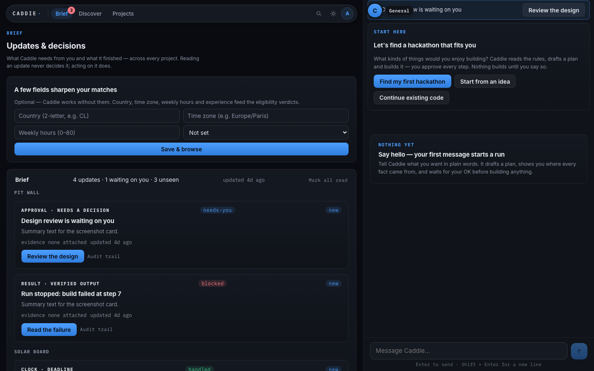

# Caddie

Caddie is an evidence-backed build assistant: it **finds** open hackathons from
live sources, **plans** a project against the contest's real rules and your real
hours, **builds** it through restricted specialists in an isolated sandbox,
**proves** it with machine-checked receipts, and **prepares** a submission
package — then stops and lets the human press Submit.

It is built as a single Cloudflare Worker (Flue 2.2.2 agents on Durable
Objects, D1, a React SPA under `/app`, and a static landing page at `/`).

This repository is the hackathon build of Caddie. Evidence labels used
throughout this file follow the project's rule: **LOCAL VERIFIED**,
**LIVE VERIFIED**, **SIMULATED**, **DOCUMENTATION ONLY**, **BLOCKED**,
**FAILED**. A mocked or local-only pass is never LIVE VERIFIED, and a model's
own account of its work is never evidence.

---

## What Caddie is

The loop is Find → Plan → Build → Prove → Ship.

| Stage | What Caddie does | Where it lives |
| :--- | :--- | :--- |
| **Find** | Reads live opportunity sources (Devpost's API plus Tavily web search), filters to open events, and ranks fit with the claims it rests on. A failed retrieval shows as a visible gap, never a confident guess. | `apps/app/src/server/discovery.ts`, `apps/app/src/server/tavily.ts` |
| **Plan** | Turns a chosen contest's rules page into an immutable snapshot and verbatim, line-cited claims; produces a versioned scope, PRD and spec, and binds approval to the exact revision. | `apps/app/src/server/rules-reading.ts`, `apps/app/src/server/planning.ts`, `apps/app/src/server/build-workflow.ts` |
| **Build** | A coordinator delegates to restricted specialists (product, designer, tech-lead, frontend, backend, mobile, QA) that write code in an isolated sandbox. Permissions are per-role; destructive and default-branch actions always need explicit approval. | `apps/app/src/agents/coordinator.ts`, `apps/app/src/agents/specialists.ts`, `apps/app/src/agents/permissions.ts` |
| **Prove** | The host — not the model — runs the checks: install, `bun test src/`, build the browser bundle, and for apps with a server, the runs-on-Cloudflare check. Receipts are recorded per check. | `apps/app/src/server/coordinator-host.ts`, `apps/app/src/server/preview-runtime.ts` |
| **Ship** | Prepares judge-rubric scoring over recorded evidence, a submission checklist with missing fields honestly missing, and a one-click publish path to a Cloudflare-hosted app. Caddie never submits for you. | `apps/app/src/server/judge.ts`, `apps/app/src/server/submission.ts`, `apps/app/src/server/publish.ts` |

### Screenshots

These are **real, committed captures** from local browser acceptance runs
(not mock-ups):

- Conversation / brief — desktop: `docs/reviews/screenshots-2026-10-09/desktop-brief-chat.png`
- Welcome chat — mobile: `docs/reviews/screenshots-2026-10-09/mobile-chat-welcome.png`
- Brief feed — tablet: `docs/reviews/screenshots-2026-10-09/tablet-brief-chat.png`



They were produced by a local run of the browser specs
(`scripts/screenshots-navigation.ts`); they are **LOCAL VERIFIED** and are
labelled as such. The landing page's own product art and the workspace cards on
it are **SIMULATED** illustrations and say so on the page — they are not live
captures.

---

## For judges

### Demo URL

**Not yet available — the hosted demo is pending deployment.** Production
deployment is a separate, owner-gated step (the plan's gate `G4`); it has not
happened, so there is **no live demo URL to give you yet**. When the owner
deploys, this section gets the URL — nothing has been stubbed in here that would
later need retracting. Until then, the only way to try Caddie is
[locally](#run-it-locally).

### Getting in (once the demo is live)

- **No Google or GitHub account needed.** Judges sign in with an **access code**,
  a judge name and a password.
- The access code is **in the Devpost testing instructions**, not in this
  repository (and it never will be).
- On the sign-in page, use the link **"Judging the hackathon? Use your access
  code"** and enter the code, then pick a judge name and a password. Returning
  judges sign in with their name and password.

### Judge limits (plain words)

The hosted demo is capped so a few dozen judges cannot exhaust it:

- **3 projects** per judge account.
- **3 builds started per 24 hours** per judge account.
- **300 Caddie messages per 24 hours** per judge account.
- **At most 40 judge accounts** in total (the code's default when
  `JUDGE_ACCESS_MAX_ACCOUNTS` is unset is `40` —
  `apps/app/src/server/judge-access.ts`).
- **Access closes on 2026-12-16** (the deployment's `JUDGE_ACCESS_UNTIL`).
- Judge accounts cannot publish apps.

These are the demo's configured limits. The 40-place cap is a code default;
the closing date and the per-account quotas are set on the deployed Worker as
owner configuration. The gate and refusal paths themselves are in
`apps/app/src/server/judge-access.ts` with tests in
`tests/judge-access.test.ts` (**LOCAL VERIFIED**).

### A two-minute path to try

*Applies once the demo is deployed.* If it is not deployed yet, run it locally
instead — see [Run it locally](#run-it-locally).

1. Open the demo URL and click **"Judging the hackathon? Use your access code"**.
   Enter the access code from the Devpost testing instructions, choose a judge
   name and password, and sign in. (~20 seconds.)
2. On the landing/home screen, ask Caddie for a project idea, or open **Find**
   to see live hackathons ranked against a profile. Pick one and open its
   detail pane to see the cited rules verdict. (~40 seconds.)
3. Ask Caddie to plan a small project. Watch it produce a scope/PRD/spec and
   stop at the review gate. Approve the plan. (~40 seconds.)
4. Let it start the build and watch the feature loop: Caddie asks the host for
   the current feature, delegates it, then runs the checks. (~20 seconds.)

You are looking for one thing above all: **every claim has a receipt**, and
when something cannot be checked, Caddie says so instead of guessing.

---

## Nebius Token Factory and NVIDIA Nemotron

Model access is Nebius Token Factory's OpenAI-compatible endpoint
(`https://api.tokenfactory.nebius.com/v1`), registered as the `nebius` provider
in `apps/app/src/agents/providers.ts` and installed once per isolate by
`registerNebiusProvider()` (called from `apps/app/src/app.ts`).

**Role → route → model id.** Both the route ids and the model ids below are the
real values in the code at the time of writing; the model ids are the exact
Nebius listing spellings (case-sensitive, including `Nemotron-3.5-…` with a dot
and `Nemotron-3_5-Lightning` with an underscore).

| Role | Route id | Nebius model id (`GET /v1/models`) | Runtime call site |
| :--- | :--- | :--- | :--- |
| `chat` | `nemotron-3.5-super-vl` | `nvidia/Nemotron-3.5-Super-VL` | `apps/app/src/agents/coordinator.ts` (`useModel`, resolved by `coordinatorModelRole`) |
| `ideation` | `nemotron-3-ultra` | `nvidia/Nemotron-3-Ultra-550b-a55b` | `apps/app/src/agents/coordinator.ts` (Home conversation) |
| `plan` | `glm-5.3-flash` | `zai-org/GLM-5.3-Flash` | `apps/app/src/agents/specialists.ts` (`specialistModelRole` → planning specialists) |
| `build` | `glm-5.3-flash` | `zai-org/GLM-5.3-Flash` | `apps/app/src/agents/specialists.ts`, `apps/app/src/server/build-workflow.ts` |
| `helper` | `nemotron-3-nano` | `nvidia/NVIDIA-Nemotron-3-Nano-30B-A3B` | `apps/app/src/server/rules-reading.ts`, `apps/app/src/server/candidate-inspection.ts` |
| `app` | `nemotron-3.5-lightning` | `nvidia/Nemotron-3_5-Lightning` | `apps/app/src/server/app-ai.ts` (`env.CADDIE.ai`, the fast tier) |
| `appSuper` | `nemotron-3.5-super-vl` | `nvidia/Nemotron-3.5-Super-VL` | `apps/app/src/server/app-ai.ts` (`tier: "super"`) |
| `vision` | `nemotron-3.5-super-vl` | `nvidia/Nemotron-3.5-Super-VL` | `apps/app/src/agents/coordinator.ts` (image turn), `apps/app/src/server/attachments.ts` |

Route definitions, prices and the role map are all in one place:
`apps/app/src/agents/providers.ts` (`MODEL_ROUTES`, `MODEL_ROLES`,
`VISION_ROUTE_IDS`). Prices carry **`PRICING_VERSION =
'2026-10-nemotron-listing'`**, re-read from a live `GET /v1/models?verbose=true`
listing on 2026-10-18. A run binding records the route and pricing it started
under, so re-pricing never silently rewrites an old run's history.

The compatibility options (`supportsDeveloperRole: false`, `supportsStore:
false`, `maxTokensField: 'max_tokens'`) exist because Token Factory rejects the
OpenAI `developer` role; the notes are on the `nebius` provider registration.

Two routes are also true vision models: `nemotron-3.5-super-vl` and
`glm-5.3-flash` (both demonstrably read an image and returned a tool call — see
`VISION_ROUTE_IDS`).

---

## The sandbox and Caddie's checks

Generated code never runs on Caddie's own host or on your machine. It runs in an
isolated sandbox reached over an HTTP sandbox API, wired in
`apps/app/src/server/build-sandbox.ts` and driven by
`apps/app/src/server/adapters/sandbox.ts` (REST client in
`apps/app/src/server/adapters/contree.ts`). The base URL, API token and platform
project come from the deployment's environment
(`CONTREE_BASE_URL`, `CONTREE_API_TOKEN`, `CONTREE_PROJECT_ID`); the setup doc
records the base URL in use as `https://api.tokenfactory.nebius.com/sandboxes`
with sessions booting from the `tag:tt-base:1` image
(`docs/setup/sandbox.md`). Without those variables, builds fail closed and say
so.

> **Owner to confirm (do not skip).** The competition's Coding track text refers
> to writing, running and testing code in **"Token Factory Sandboxes"**. Caddie's
> sandbox is reached through `CONTREE_BASE_URL` on a Token Factory account, but
> **this repository cannot confirm that this endpoint is the product the rules
> call "Token Factory Sandboxes"**. Until that is confirmed against the Nebius
> documentation or the rules FAQ, this README deliberately does **not** use the
> rules' term as if it were established. The owner must confirm the naming
> before submission (the plan's S08 records the same condition).

### The host-enforced feature loop

A build is never "done" because the model says so. The host owns the loop
(`apps/app/src/server/coordinator-host.ts`,
`apps/app/src/server/build-features.ts`):

1. **`build_next_feature`** — the coordinator asks the host which feature is
   current. It may only work on that one; it cannot pick a different one.
2. **`run_checks`** — the implementation specialists run the project's checks
   **only** through this host tool: install dependencies, run `bun test src/`,
   build the browser bundle. Shell test commands are refused outright (an
   earlier build escaped the repair counter by piping a test command through
   `head`), and the refusal is in `apps/app/src/server/coordinator-host.ts`.
3. **`finish_feature`** — the host re-runs the checks, and additionally requires
   that this feature added **new passing tests** compared with the baseline it
   recorded before the feature started (`passing > baseline`). No new tests, no
   finished feature. Failures count against a bounded repair limit (three on the
   same issue), after which the run pauses for a human.
4. **`verify_build`** — the QA specialist asks the host for the final check.
   Only this path publishes a preview and saves a version.

### The runs-on-Cloudflare check

An app with a server must start **on Cloudflare's runtime**, not merely under
Bun in the sandbox. `checkServerStarts`
(`apps/app/src/server/preview-runtime.ts`) loads the app's server bundle in an
isolated Worker Loader with no database and no network, and requires
`GET /api/health` to answer **200**. A failure is recorded as its own check
(`server-starts`) with the real reason, and the coordinator is told to fix
`src/server.ts` — never to claim success.

**A model's own claims never count as evidence.** Every check above is executed
by the host, and success is a recorded machine receipt (exit code, command,
checkpoint). `record_acceptance` and other "trust me" inputs are explicitly
refused: caller-supplied pass flags are not evidence
(`apps/app/src/agents/tools.ts`).

---

## Tavily (bonus award)

Tavily is the project's search provider, and it is used for two distinct jobs.
There is exactly one client — `apps/app/src/server/tavily.ts` — with one typed
wrapper per endpoint:

| Tavily endpoint | Wrapper | Call sites | What it feeds |
| :--- | :--- | :--- | :--- |
| `POST https://api.tavily.com/search` | `tavilySearch` (`tavily.ts`) | `apps/app/src/server/discovery.ts` (domain-scoped multi-query sweep), `apps/app/src/server/coordinator-context.ts` (`researchForActor`, Caddie's research tool) | The **Find** feed's candidates (deduped by URL, filtered to real, open event pages), and cited research findings for a chat answer. |
| `POST https://api.tavily.com/extract` | `tavilyExtract` (`tavily.ts`) | `apps/app/src/server/rules-reading.ts` (contest rules pages), `apps/app/src/server/coordinator-context.ts` (a URL the user names) | Immutable page snapshots that are then read for **verbatim, line-cited claims** — the eligibility verdicts, deadlines and constraints the rest of the product reasons over. |

Failures are visible, never silent: a missing `TAVILY_API_KEY` raises
`TavilyNotConfiguredError`, discovery records a named feed gap, and the research
tool tells the user research is off rather than inventing an answer.

---

## What changed during the submission period

Read from this repository's own `git log` (this is a ground-up rebuild, not a
continuation of the earlier `caddie` project — no history was carried over).

| Date | What landed |
| :--- | :--- |
| **2026-10-03** | **First commit.** The fresh-build plan rescued from the planning session, then the bootstrap and frozen shared contracts (P00). |
| 2026-10-04 – 10-06 | Packets P00–P17: identity and sign-in, projects and approvals with budgets, the sandbox driver, specialists and the coordinator, evidence and previews, GitHub, artifacts, discovery, judge/submission, tasks and schedules, profile, the four extra stacks (TanStack Start, Laravel, FastAPI, Flutter), the landing page, and the release-check harness. |
| 2026-10-07 – 10-10 | Home (the project-less conversation with Caddie) and five waves of UI redesign (U01–U10), plus saved hackathons, search, per-scope chat threads and in-chat spend approval (B01–B06). |
| 2026-10-15 – 10-16 | Project-page redesign around "what Caddie is doing now", the host-driven feature build loop, the PRD + design review step, saving source to GitHub as a PR, and model re-routing (vision moved to a served VLM). |
| 2026-10-17 | The publish programme: `Publish on Cloudflare` plan, app-host ports and the Cloudflare adapter (Workers for Platforms, D1, KV routes, custom hostnames), an Artifacts-backed code store, and running an app's server in a Worker Loader isolate for previews. |
| 2026-10-18 | Publishing end to end (service, `/api` routes, the Publish card, safety scan + takedowns), keys for outside services, AI inside generated apps with a per-project allowance, app sign-in, versions/restore, "Start from my GitHub repo"; then S01–S04: one packet table with a completeness net, a purpose-specific report rate-limit key, model routing re-read from the live Nebius listing, and the fast/super app-AI tiers. |
| **2026-10-19** | S06: judges sign in with an access code, a name and a password (no Google or GitHub, no email delivery); models re-priced from the live listing with `helper` returned to Nemotron Nano; CI tightened to `--frozen-lockfile`. |

---

## Status table

Conservative and per-surface. "Not built" and "not deployed" are recorded as
such rather than omitted.

| Surface | Status | What backs it |
| :--- | :--- | :--- |
| Test suite (`bun run test`) | **LOCAL VERIFIED** | 1368 pass, 0 fail, 105 files — run at the time of writing. |
| Typecheck (`bun run typecheck`) | **LOCAL VERIFIED** | exit 0 (root project + `apps/app`). |
| Build composition (`bun run build`) | **LOCAL VERIFIED** | One composed Workers assets tree from the Astro landing + Vite SPA. |
| Model round-trips on Nebius Token Factory | **LIVE VERIFIED** (recorded 2026-10-06) | Owner-authorized runs recorded in `docs/release-evidence.md` and the execution ledger (P05); the route/pricing table is refreshed from a live listing (2026-10-18). |
| Sandbox execution | **LIVE VERIFIED** (recorded 2026-10-06) | Real contree session + remote exec probe recorded in `docs/release-evidence.md` (P04), and a full React+Hono journey (P09). |
| React + Hono generated-app journey | **LIVE VERIFIED** (recorded 2026-10-06) | The journey runner passed every phase in the sandbox (P09) — the only stack marked verified; the other four stacks are **BLOCKED** on their own live gates. |
| Real outbound email (Resend) | **LIVE VERIFIED** (recorded 2026-10-06) | One real send to the owner's own address, provider receipt id in `docs/release-evidence.md` (P12). |
| Judge access by code (`S06`) | **LOCAL VERIFIED** | `tests/judge-access.test.ts`; the gate, rate limits and refusals are tested. Not exercised against a deployed Worker. |
| Landing page product art / workspace illustrations | **SIMULATED** | Labelled on the page itself: illustrative compositions, not live captures. |
| **Hosted demo (the judge URL)** | **NOT BUILT / not deployed** | Production deploy is owner-gated. There is no demo URL yet. |
| App publishing (Workers for Platforms) | **Not deployed** | The dispatch Worker is **PROPOSED** (`workers/dispatch/wrangler.jsonc`); the publish service and `/api` routes exist locally. |
| Custom domains for published apps | **Not built** | Only the plan and the adapter's headroom exist; nothing is configured. |
| Cloudflare Artifacts code store, Web Risk safety scan, Worker Loader preview on a **deployed** Worker | **Not live-verified** | Implemented and locally tested; never run on a deployed Worker. |
| Licence audit (`bun scripts/license-audit.ts`) | **LOCAL VERIFIED** — and currently **not clean** | 24 production dependencies, 2 flagged (`@fontsource/inter` and `@fontsource/ibm-plex-mono`, both OFL-1.1 — a permissive font licence outside this project's allowed set). Full table in `docs/licenses.md`. |
| Screenshots in `docs/reviews/` | **LOCAL VERIFIED** | Real captures from local browser acceptance runs (2026-10-08 / 2026-10-09). |

---

## Run it locally

Requires [Bun](https://bun.sh) 1.4.x. `.dev.vars` is gitignored; never commit or
print secrets.

```sh
export PATH="$HOME/.bun/bin:$PATH"

bun install
cp .dev.vars.example .dev.vars     # then fill in what you need
bun run db:migrate:local           # local D1
bun run dev                        # dev server pinned to http://localhost:5176
```

The SPA is served under `/app` (`http://localhost:5176/app`); the landing page is
at `/`. Sign-in and model calls need credentials in `.dev.vars`; without them the
app runs and fails closed with visible gaps.

### Tests and checks

| Command | What it is | Last observed |
| :--- | :--- | :--- |
| `bun run test` | The local unit/integration suite (`bun test tests/`, browser and live specs excluded) | **1368 pass, 0 fail, 6471 expect() calls, 105 files** |
| `bun run typecheck` | Root project + `apps/app` typecheck | exit 0 |
| `bun run build` | Astro + Vite + asset composition into one Workers assets tree (no deploy) | exit 0 (LOCAL VERIFIED) |
| `bun run verify:packet Pxx` | That packet's mapped tests; fails when a mapped test file is missing or empty | — |
| `bun run test:browser -- Pxx` | Browser specs against the composed build (`bun run build` first) | — |
| `bun run test:live -- Pxx` | Live specs; gated behind `CADDIE_LIVE_AUTHORIZED=1` and real credentials | BLOCKED without owner authorization |
| `bun scripts/license-audit.ts` | Third-party licence audit → `docs/licenses.md` | 22 allowed, **2 flagged**, 0 unresolved (exit 1) |
| `bun scripts/release-check.ts` | The local release gate (deployment is always BLOCKED by design) | — |

Also in the repo: **34** SQL migrations (`apps/app/migrations/0001_…` →
`0034_judge_usage_events.sql`), counted at the time of writing
(`ls apps/app/migrations/*.sql | wc -l`).

---

## Licence

MIT — see [`LICENSE`](LICENSE). Third-party licences and the current audit
result are in [`docs/licenses.md`](docs/licenses.md).
