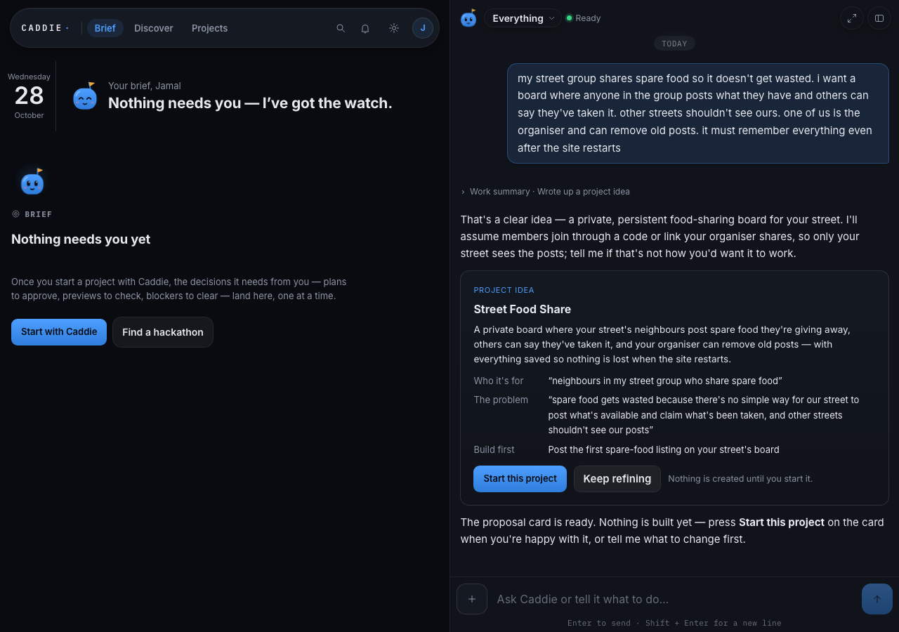
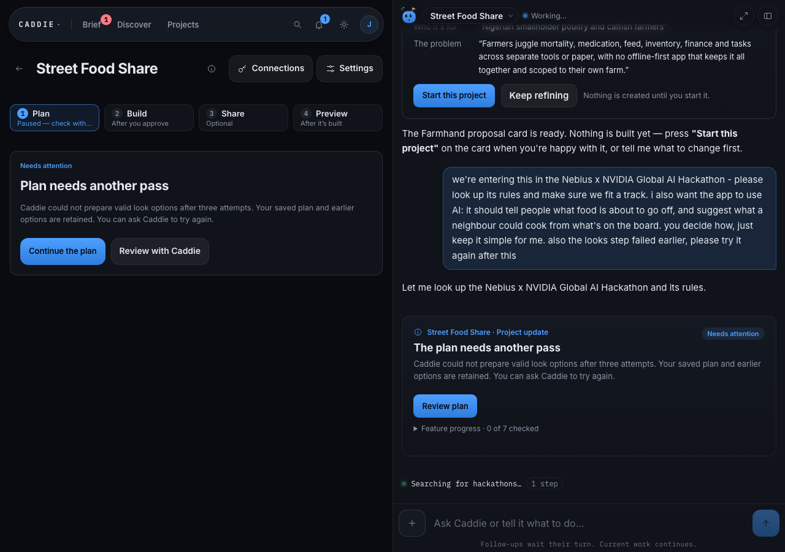
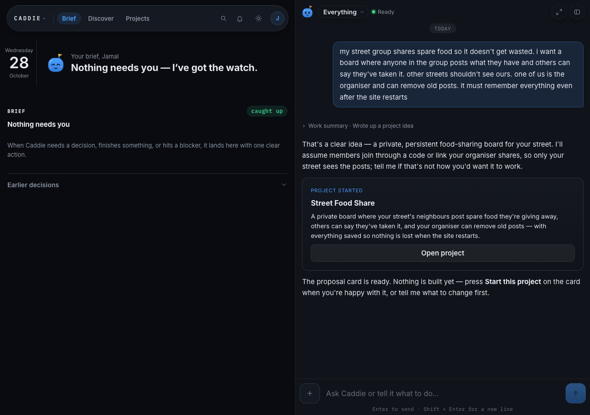
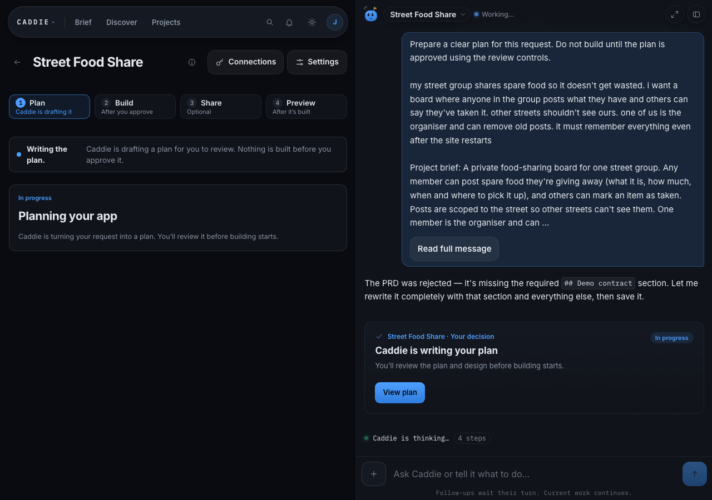

# Building an app the way a lazy, non-technical user would

Date: 2026-10-28 · Driver: Qoder agent acting as the user · Identity: the owner's
own signed-in account (invite-listed Google user) on the local dev server.

## What this run is for

The owner asked for one thing: *"go through the app as a lazy non-technical user
and build whatever app you can that truly showcases what Caddie can do."* So the
rule for this run was: **never type anything a non-technical person could not
type.** No SQL, no JSON, no shell commands against the app, no editing generated
code. Every step is a click or a plain-English sentence in the chat box, and
every claim below is either something the screen showed or a row the app itself
wrote.

The target is a Nebius-hackathon entry, so the app must genuinely use AI — and
the user must never have to learn what a model route is to get it.

## Setup (LOCAL VERIFIED, no config invented for the run)

| Piece | State |
|---|---|
| App | `bun run dev` already serving at `http://localhost:5176` (pinned port) |
| Database | local dev D1, already at the folded 4-file schema; no reseed needed |
| Model provider | Nebius key present in `apps/app/.dev.vars` (values never printed) |
| Sandbox | Contree base URL + token present |
| Private browser checks | `scripts/serve-design-capture.ts` started on `127.0.0.1:5191` |
| Live authorisation | `CADDIE_LIVE_AUTHORIZED=1` present in `.dev.vars` |
| Per-build cap | `SPEND_LIMIT_CAP_USD=4.48` |

Sign-in was not re-done: the run reused the session row the owner's own Google
sign-in had already created, by injecting that cookie into a Playwright browser
(`test-support/caddie-walk.mjs`, temporary and uncommitted). Nothing about the
credential path is new — it is the same technique `test-support/farmhand-drive-app.mjs`
used on 2026-10-27.

## Step 1 — one messy paragraph, zero technical knowledge

Typed into the home chat exactly as a person would type it:

> my street group shares spare food so it doesn't get wasted. i want a board
> where anyone in the group posts what they have and others can say they've
> taken it. other streets shouldn't see ours. one of us is the organiser and can
> remove old posts. it must remember everything even after the site restarts




What came back, unprompted: a **PROJECT IDEA** card named *Street Food Share*,
with who it's for, the problem in the user's own words, the first thing it will
build, and two buttons — *Start this project* / *Keep refining*. It also stated
the one assumption it had made (members join through a code or link the organiser
shares) and invited a correction. The chat line under the card said plainly:
*"Nothing is created until you start it."*

**Nothing was asked of the user.** No stack choice, no schema, no repo, no model.

## Step 2 — one tap creates the project

*Start this project* → the card flips to **PROJECT STARTED** with *Open project*,
and the workspace grows the stepper **1 Plan · 2 Build · 3 Share · 4 Preview**.




Project id `proj_ec1067a3716db4969fcd861f210a3ad2`, created 15:22:05Z. The Plan
step read *"Caddie is drafting a plan for you to review. Nothing is built before
you approve it."*

## Step 3 — the quality gate argued with itself, and the user could watch

This is the part that is hard to fake, and it happened on its own. The rows the
app wrote (read out of the local D1, not from a model's summary):

| kind | round | candidate status | reviewer verdict |
|---|---|---|---|
| prd | 1 | revise | revise |
| prd | 2 | published | pass |

`quality_projects` recorded `policyVersion=quality-v1` with
`authorRouteId=deepseek-v4.1-flash-1017`; the reviewer that passed round 2 is a
different route, which is the point of the gate — the author never marks its own
homework.

The chat showed the same thing in human language:

> The PRD was rejected — it's missing the required ## Demo contract section.
> … The host found issues in my PRD — a missing link-join flow, no real auth for
> organiser deletes, unauthenticated reads, no post-form error recovery, and a
> demo that doesn't show joining or street scoping. Let me fix all of these and
> re-save.

Those are real review findings, not a summary written after the fact: the first
draft genuinely omitted the demo contract and the organiser-authorisation path.

The saved plan (revision `pdr_a9fbb3bc-87ed-4190-b665-ed06dd46c5db`) carries 7
features in build order: create street, join by code/link, post food, browse
board, mark taken, organiser remove, persist across restart.

## Step 4 — where a real user would have given up

The next step after the plan is *choose a look*, and it failed three times:

> **Plan needs another pass** — Caddie could not prepare valid look options after
> three attempts. Your saved plan and earlier options are retained. You can ask
> Caddie to try again.

`build_workflows.phase` is `blocked`. The agent's own narration names the cause,
and it is a product bug, not a model mistake:

> I see — the host wants exactly ONE shared html-mock block, with per-look screen
> compositions inside the caddie-looks JSON. … Now I understand — the screens key
> isn't allowed in the look JSON.

The look format the host accepts moved under the designer, three rewrites burned
the retry budget, and the pipeline stopped. A non-technical user reading the
screen has no idea what "look options" were, that they are recoverable, or that
"Review plan" and "Continue the plan" are different buttons. **This is the single
worst moment in the walkthrough**, and it is the one to fix first.

## What it cost

Settled spend through 16:41Z, read from the app's own `model_calls` rows (LIVE
VERIFIED, not a self-report): **$0.8776** across 74 Coordinator calls, of which
**$0.7591** is attributable to this project's conversation; the independent
plan-quality reviewer spent **$0.4002** over 7 calls (its rows carry no
conversation id, so they cannot be attributed to one project — an honest gap in
the accounting); the direct-helper route $0.0287 over 29 calls. Planning is
booked to `preparation:` payers, not the build campaign, so the $4.48 per-build
cap never came close. The earlier figure in this document ($0.0746 / 5 calls) was
a snapshot taken before the replan.

## Defects found by behaving like a user

1. **Looks step is brittle** (blocking). Three rejected saves and the project is
   `blocked`, with copy that tells the user nothing about what to do. Root cause
   and the two fixes: see "Why the looks step really failed" below.
2. **`Maximum update depth exceeded` in the client** (reproducible, non-blocking).
   Logged repeatedly on the home/brief screens and while a project streams. Needs
   a React diagnosis — likely a `setState` in an effect tied to the live
   conversation store.
3. **Two agents, one account, one transcript** (observation). A *Farmhand* idea
   card another session typed at 15:26Z appears interleaved in the same home chat
   above this project's messages. For a real user this reads as Caddie mixing up
   their requests.
4. **The plan locks after the plan step** (blocking). Once `phase` left
   `planning`, `write_plan_note kind:'prd'` was refused with
   `The artifact does not belong to the current preparation step` — a
   `QUALITY_WRONG_PHASE` 409 from the quality-gate phase check
   ([apps/app/src/server/artifact-quality.ts:33](file:///Users/captjay98/projects/caddie-forge/apps/app/src/server/artifact-quality.ts#L33)).
   Kernel and scope took the AI/hackathon edits; the PRD — the document the
   review card actually shows — could not. The owner's "update the plan first"
   has no route except the `planning_blocked` card's "Continue the plan" button
   ([apps/app/src/server/project-experience.ts:312](file:///Users/captjay98/projects/caddie-forge/apps/app/src/server/project-experience.ts#L312)).
5. **Internal model tiers reached builder-facing copy** (against the "no model
   names" rule). Caddie's own reply at 15:56Z listed "AI suggestion (tier:fast
   super) and recipe expiry prediction (tier:…)". The builder was told to keep it
   simple and never pick a model; the routing tier names must stay server-side.
   Fixed with defect 11 below — same leak, other surface.
6. **The reviewer is never told what the owner asked for** (blocking, and the
   reason the plan could not be re-saved). The independent gate is instructed
   that candidate text proves nothing, and it is then shown only
   `{userIntent, approvedPlan, chosenLook}`
   ([apps/app/src/server/artifact-quality.ts:91](file:///Users/captjay98/projects/caddie-forge/apps/app/src/server/artifact-quality.ts#L91))
   — the *original* brief (which says "no third-party AI keys required") and the
   earlier PRD revision, under a field named `approvedPlan`. Nothing in this
   project was ever approved: `approvals` and `plan_decisions` have zero rows for
   it, so the field name told the reviewer a superseded draft was a binding
   approval, and the owner's later change of mind exists in no table a reviewer
   can read (`pendingBody` is consumed on delivery, `run_rounds` is empty). The
   16:19:45Z refusal is that design working exactly as written. A scope change
   the owner is entitled to make cannot pass the gate — the catch-22 is host-side,
   and the reproduction is now a 10ms test.
7. **Fixing the review-window deadlock replaced it with a foreign-key crash**
   (blocking, LIVE VERIFIED at 17:16:09Z). The window fix that was in the tree
   renewed an expired admission by `delete from quality_admissions` plus
   `delete from build_spend_limits`
   ([apps/app/src/server/artifact-quality.ts:43](file:///Users/captjay98/projects/caddie-forge/apps/app/src/server/artifact-quality.ts#L43)).
   Both rows are referenced with `ON DELETE NO ACTION` — every
   `artifact_candidates.admissionId` points at the admission, every
   `build_spend_reservations.payerId` at the payer — so on a project that had
   already produced candidates (Street Food Share had two) the renewal aborted
   and the owner's turn died 12 ms after it started:

   ```
   17:16:09.213Z agent_start_run
   17:16:09.222Z assistant_message_completed stop=error
     err="D1_ERROR: FOREIGN KEY constraint failed: SQLITE_CONSTRAINT_FOREIGNKEY"
   ```

   A planning-phase project therefore had *two* ways to become unanswerable: the
   original `QUALITY_TIME_LIMIT` (16:40:12Z, same 9 ms death) and, once the
   renewal landed, this crash. The version now in the tree opens a numbered
   window row (`-w2`, `-w3`…) instead of deleting, which is why the next send at
   17:20:32Z reasoned normally rather than erroring. Note the sharing hazard this
   run kept hitting: the fix had to be *live* to be true, and a worker that had
   been up since 16:22Z kept answering with the older module.
8. **Replying to a card from the home screen starts a new project** (product
   defect, non-blocking, LIVE VERIFIED). The owner's "Yes, please put that AI
   idea into the plan and carry on" was typed into the composer on `/app/`, the
   screen that was showing the Street Food Share card. Caddie treated the reply
   as a fresh idea and created **Farmhand Poultry & Catfish**
   (`proj_b64ba7be71593cc2ea96ac0132cd9769`, 16:55:56Z), taking it all the way to
   a published PRD revision — a paid, plausible-looking project nobody asked for.
   Nothing on the home screen says the composer is "start a project", and no
   confirmation asks "this will be a new app, not an answer to Street Food
   Share?". A lazy user answers the card in front of them.

## Why the looks step really failed

Evidence: the coordinator's own tool results, read out of the Durable Object's
conversation stream (`flue_conversation_stream_batches` for
`agents/Coordinator/conv_ec1067a3716db4969fcd861f210a3ad2`, copied to a scratch
SQLite because the dev server holds the WAL). Every `write_plan_note kind:'looks'`
refusal, in order:

| time | what the designer sent | host refusal |
| --- | --- | --- |
| 15:23:51Z | prose, no block | `the looks proposal has no `caddie-looks` block` |
| 15:3xZ | three ```html-mock blocks, one per look | `use ONE shared html-mock block; put different compositions in each look.screen` |
| 15:3xZ | one `screens: {…}` key inside each look | `look "neighbourly" is invalid at screens: Invalid key: Expected never but received "screens"` (×3) |
| 15:35:09Z | — | `phase = blocked`, "after three attempts" |

So it was doing exactly what the refusal told it to do and still being rejected.
Two separate defects, both on the host side:

1. **The generation guide contradicted itself.** `LOOKS_BLOCK_GUIDE` demanded
   "EVERY look must carry its own screen: {title, html}" while its own complete
   valid example had no `screen` key at all, only one shared ```html-mock block
   ([packages/contracts/src/looks.ts:189](file:///Users/captjay98/projects/caddie-forge/packages/contracts/src/looks.ts#L189)).
   The name of the key never appeared in the sample, so the model invented
   `screens`, and `AppThemeSchema` is a `strictObject` — an unknown key fails the
   whole look with an opaque schema message.
2. **A project blocked at the look step had no way back to the look step.** The
   card promises "You can ask Caddie to try again", but an ordinary chat message
   only parked the request while `phase` stayed `blocked`, and the retry path that
   does change phase jumped to `building`
   ([apps/app/src/server/build-workflow.ts:2188](file:///Users/captjay98/projects/caddie-forge/apps/app/src/server/build-workflow.ts#L2188)). Even a *valid* looks proposal saved afterwards stayed
   invisible: the picker auto-advance runs only when the phase is already `looks`
   ([apps/app/src/server/build-workflow.ts:437](file:///Users/captjay98/projects/caddie-forge/apps/app/src/server/build-workflow.ts#L437)).

### Fixes applied

- **Refusal names the key.** A look carrying `screens`/`mock`/`preview`/`html`
  instead of `screen` now gets `each look carries one "screen" object — the
  singular key screen with exactly {"title", "html"}`
  ([packages/contracts/src/looks.ts:44](file:///Users/captjay98/projects/caddie-forge/packages/contracts/src/looks.ts#L44)),
  and the guide states the key, its shape and the one-shared-mock rule in the
  same breath as the sample.
- **Blocked-at-looks resumes looks.** `resumeLooks()` puts the workflow back in
  the look step with a fresh `looksMessage` (so the fixed guide rides along) and
  carries the user's own words; an ordinary project-chat message triggers it, and
  `retryWorkflow` routes there instead of to building. The judge still pays one
  Caddie message, same as `resumePlanning`
  ([apps/app/src/server/build-workflow.ts:1996](file:///Users/captjay98/projects/caddie-forge/apps/app/src/server/build-workflow.ts#L1996)).

LOCAL VERIFIED: `bun test tests/looks.test.ts tests/build-workflow.test.ts` →
**142 pass / 0 fail**, `bun run typecheck` clean. The new regression test
"a project blocked at the look step resumes the look step, never the build" was
run red first — it failed with exactly the live behaviour (`phase` stayed
`blocked`) before the fix. Neither fix is LIVE VERIFIED yet; the retry through
the running app is the next section.

## Step 5 — pressing the button the card actually offered

At 15:46Z the owner (this agent, in the owner's plain voice, no model names) sent
one message in the project chat asking for the plan to be fixed *before* the
looks: the Nebius x NVIDIA track requirements, plus "spot food that's about to go
off" and "suggest what a neighbour could cook from what's on the board", working
offline. The coordinator's own narration at 15:56Z shows what happened:

> The project is stuck in **planning_blocked** after three failed looks attempts.
> The kernel and scope already include the AI/hackathon additions, but the phase
> won't accept new plan notes (PRD or looks) — every save returns "The artifact
> does not belong to the current preparation step".

That is defect 4 above. What saved the run was not a code change: the paused
screen already offered **"Continue the plan"** as its primary action, and the
resume behind it routes a pre-approval block back to planning
(`retryWorkflow` → `resumePlanning`,
[apps/app/src/server/build-workflow.ts:1955](file:///Users/captjay98/projects/caddie-forge/apps/app/src/server/build-workflow.ts#L1955)).

LIVE VERIFIED (the app's own records, not a self-report):

- 16:08:35Z the signed-in owner pressed "Continue the plan" in the real client
  (`test-support/caddie-walk.mjs` against `localhost:5176`; screenshot
  `shots/05-continue-the-plan.png`). The screen changed to **"Caddie is
  drafting it"** and `build_workflows.phase` went `blocked` → `planning`.
- The coordinator then authored the PRD itself ("no subagents available, so I'm
  authoring the PRD directly as the product specialist") and the **independent
  plan-quality gate refused it twice on real grounds**. Both refusals are the
  app's own `artifact_quality_reviews` rows (verdict `revise`), not the model's
  self-report:
  - 16:17:00Z, candidate `7176f729…`, `restart persistence proof`: the plan
    proved only a *page reload* while the owner's requirement is "remember
    everything even after the site restarts" — "a page reload passes even with an
    in-memory store".
  - 16:19:45Z, candidate `751f6a9b…`, `Scope consistency with approved plan`:
    "The approved plan in force states 'AI: None… no model, no call path, no
    third-party AI key is needed or used' and lists 'AI features' as a non-goal,
    but this PRD adds two AI features (freshness prediction and recipe
    suggestion)… that approval is not verifiable from the approved plan supplied."
  Both AI features are now named in the draft — `freshness-check` and
  `recipe-suggest`, with routes `POST /api/posts/:id/freshness` and
  `POST /api/recipes` — so the owner's ask survived into the plan; what the gate
  wants is the *change of mind* on the record, which is exactly what the review
  card's own decision flow is for.

Walkthrough honesty note: four identical messages at 15:48, 15:50, 15:53 and
15:56Z, written in a technical voice ("`c.env.CADDIE.ai` on Nebius Token Factory,
tier super for expiry prediction and fast for recipe suggestion"), were sent by
**the previous agent session**, not by a user. They are the opposite of the
non-technical brief, they burned four model turns, and they are what leaked the
tier names into Caddie's reply (defect 5). From here on the walk only ever types
in the owner's voice or presses the card's own buttons.

## Step 6 — the reviewer said "the owner never asked", so the owner's words were put on the record

The 16:19:45Z refusal quoted above is the whole story: the independent reviewer
will only accept a scope change it can see **as the owner's own words**, and
nothing in the database carried those words. Its reasoning at 17:38Z named the
gap directly — `ownerRequests is empty`.

The reviewer reads `ownerRequests` from `plan_decisions` rows where
`decision = 'changes'` and a note exists
([apps/app/src/server/artifact-quality.ts:90](file:///Users/captjay98/projects/caddie-forge/apps/app/src/server/artifact-quality.ts#L90)).
A chat message never wrote one: the composer POSTs straight to
`/agents/coordinator/<conversationId>`, and the workflow's own chat entry point
is only reachable when the model decides to call the `continueProject` tool.

Fix, in the order it was learned:

1. Record the owner's text where the person's typing is actually held — the
   conversation guard, before the coordinator runs
   ([apps/app/src/server/routes/runs.ts:160](file:///Users/captjay98/projects/caddie-forge/apps/app/src/server/routes/runs.ts#L160)),
   through the new `recordOwnerChangeRequest`
   ([apps/app/src/server/build-workflow.ts:2181](file:///Users/captjay98/projects/caddie-forge/apps/app/src/server/build-workflow.ts#L2181)).
   A message the server dispatched itself is a framework prompt and never reaches
   the line.
2. Only a human boundary may write the field. Live proof of why: at 17:47:51.716Z
   a `plan_decisions` note appeared reading *"The owner has confirmed the full
   scope: Nebius x NVIDIA hackathon entry (Oct 30, $50k, … tier:super …)"* — that
   is **agent prose** sitting in the field the reviewer is told to trust as the
   owner's words. Any author able to write its own "owner request" could authorize
   any scope it liked. So the two model-reachable writers were removed
   (`continueProjectFromChat`, and the decision write in `resumePlanning`), and
   the home-screen handoff — which forwards the owner's delivery text verbatim —
   was allowed to record
   ([apps/app/src/server/coordinator-host.ts:1825](file:///Users/captjay98/projects/caddie-forge/apps/app/src/server/coordinator-host.ts#L1825)).

LOCAL VERIFIED: `bun test tests/build-workflow.test.ts` → 131 pass / 0 fail
(961 expect), including a test that a framework resume prompt is **not** recorded
and a 10-assertion test that a typed project message **is** recorded, deduped,
and never recorded against a looks or design revision (which would silently read
as "the owner already answered that card" and suppress its auto-advance).
`bun test tests/artifact-quality.test.ts` → 6 pass; `bun run typecheck` → clean.

LIVE VERIFIED, the chain end to end:

- 17:47:29.107Z the owner's typed message produced the first
  `decision='changes'` row on the PRD revision — written by the guard, not the model.
- A new decision row changes the quality gate's `dependencyHash`, so the next
  preparation opened a fresh admission with fresh candidate rounds.
- 17:56:15.609Z `artifact_quality_reviews` verdict **`pass`** on PRD revision 2,
  with only an advisory finding (offline demo proof vs stated offline limits).
- 17:56:15.613Z `plan_doc_revisions` revision 2 published as
  `pdr_715accd3-0b2d-4c03-82b9-951f58fe25bb`; `build_workflows.phase` → `review`;
  the screen showed **"Plan version 2 / Ready to review"** and the
  "Does this plan look right?" card (`13-plan-version-2-ready-to-review.png`).
- 18:08:34.219Z the owner pressed **Approve plan** in the real client. The card
  opens a confirmation window first (`14-approve-plan-confirm-dialog.png`);
  `approvals` row `apr_eb3bbe82…` and `plan_decisions` row `approved` both bind
  **revision 2**, and `build_workflows.phase` moved to `looks`.

## Defects found in this stretch (additions to the list above)

9. **The reservation estimate, not the price, is what stops a first-pass PRD.**
   Corrected after the owner rejected the "$1.00 is too tight" framing (and the
   numbers agree). The looks preparation window reserved **$2.255 and settled
   $0.548** across 8 turns, with nothing left outstanding (`select status,
   count(*), sum(reservedMicros), sum(settledMicros) from
   build_spend_reservations …` → one row, `settled`); two coordinator turns
   reserved 499,976 and 506,837 micros and settled 31,500 and 37,686 — the guard
   (`build_spend_reservations_limit_guard`,
   [apps/app/migrations/0003_team_build.sql:33](file:///Users/captjay98/projects/caddie-forge/apps/app/migrations/0003_team_build.sql#L33))
   trips on a worst-case estimate about **15x the real cost**. Separately, 3 of
   the 4 PRD rounds (17:38/17:39/17:40Z) were burned on the unsatisfiable
   `ownerRequests is empty` reviewer bug, since fixed — so the rounds were not
   "improvements", they were a product defect. The real money is not the
   constraint; the estimate is. Ceiling left untouched (the owner's call).
   **LIVE, 19:10Z — the estimate can also deadlock a step that spent nothing.**
   The owner's next message arrived at 19:10:38.226Z; the expired looks window
   correctly rolled to `prep_7db5e7a5…-w2` with a **fresh $1.00 payer** at
   19:10:38.248 (the window fix from defect 6 works on the live app). One second
   later the first turn of that window reserved **518,136 micros — $0.518, 52% of
   the whole step's allowance for a single call.** The walkthrough browser then
   closed mid-stream, no usage was reported, so the row stayed `status:'reserved',
   settledMicros:null` — deliberately, because "an error or missing usage is not
   proof that the provider did no work"
   ([apps/app/src/server/spend-instrument.ts:269](file:///Users/captjay98/projects/caddie-forge/apps/app/src/server/spend-instrument.ts#L269)).
   The next call's estimate plus that held liability crossed $1.00, the guard
   refused it, and the app said "This build reached its spending limit of $1.00"
   while the client rendered "Caddie hit a problem and could not finish that
   request." **The step died 16 seconds into a brand-new window having cost
   $0.00.** Measured on the same rows: the estimate is 2.7x–15x the settled cost
   (485,537→178,271; 493,084→180,608; 499,976→31,500; 506,837→37,686). It is not
   the fallback either — the costliest route's no-request-size estimate is
   424,180, so 518,136 came from a real request of roughly 0.5–0.8M characters
   (≈265k–400k tokens at 1 token per 2 chars,
   [apps/app/src/server/build-spend.ts:193](file:///Users/captjay98/projects/caddie-forge/apps/app/src/server/build-spend.ts#L193)):
   the coordinator carries its whole context into every turn. Two levers follow,
   both the owner's call and neither of them the ceiling — pricing the input
   closer to what a cached turn actually costs, and returning a worst-case
   reservation once its turn is provably gone. Until one lands, any step needing
   two coordinator turns inside one window can stop at $0.00 spent.
10. **Internal framework prompts rendered in the transcript as if the owner typed
    them — FIXED, LIVE VERIFIED 19:10:38Z.**
    "You at 16:37", "You at 16:53" carry Caddie's own dispatch text into the
    owner's bubble. Root cause, two halves:
    - `workerSelfDeliver` posted every parked step prompt as `kind: 'user'`
      ([apps/app/src/server/workflow-dispatch.ts:279](file:///Users/captjay98/projects/caddie-forge/apps/app/src/server/workflow-dispatch.ts#L279)),
      so on the wire it is indistinguishable from the person's message.
    - the Home→project handoff may pass **model prose** as the request
      (`delivery.kind === "user" ? delivery.body : ctx.data.request`,
      [apps/app/src/agents/coordinator.ts:534](file:///Users/captjay98/projects/caddie-forge/apps/app/src/agents/coordinator.ts#L534)),
      which is how `plan_decisions` came to hold "The owner has confirmed the
      full scope: … `c.env.CADDIE.ai tier:super` …" at 17:47:51Z and 17:50:03Z
      beside the owner's real words from 17:47:29Z.
    Fix: a dispatched message now carries a `voice` — `owner` for the person's
    own words, `control` for a prompt Caddie wrote — and a control step is posted
    as a caller-defined signal (`kind:'signal'`, type `caddie.workflow`). Flue
    classifies an application signal as `purpose:'dispatch'` /
    `display:'diagnostic'` (`classifySignal`, pinned runtime
    `dist/dispatch-BlxCz6iq.mjs:2366`), and the channel already refuses to put a
    non-assistant message in the owner lane
    ([apps/app/src/client/conversation/Channel.tsx:109](file:///Users/captjay98/projects/caddie-forge/apps/app/src/client/conversation/Channel.tsx#L109)).
    The model still receives the text: this is the same mechanism
    `plan_incomplete`/`coordinator_context` already use inside the coordinator.
    LOCAL VERIFIED: `bun test tests/workflow-dispatch.test.ts tests/judge-limits.test.ts`
    → 54 pass / 0 fail (101 + 184 expects), including the new wire-shape tests
    and the derivation (intake = owner, `decision:`/`relooks:`/`retry:`/`continue:`
    = control); `bun run typecheck` clean.
    LIVE VERIFIED at 19:10:38Z against the running app, on the wire and on
    screen. The owner's own message was posted as
    `role:'user' purpose:'user' display:'visible'` (`entry_direct_c3ViX2lr…`) and
    the framework text that follows it — the coordinator context the model
    receives — as `role:'system' purpose:'dispatch' display:'diagnostic'`
    (`entry_01M61YQT4ZCGK7PG04ETR94B41`), read from
    `GET /agents/coordinator/conv_ec1067a3716db4969fcd861f210a3ad2` with the
    owner's session cookie. In the rendered transcript the owner lane shows one
    bubble with the person's words ("You at 20:10 The plan is approved on my
    side…") and no second "You at" bubble carrying Caddie's dispatch text — the
    18:35/18:36 duplicate pair this defect recorded is gone. Known remaining case,
    deliberately untouched here: the `intake:`
    message is still owner-voice even though `propose_project` appends
    model-written "Project brief:" prose to it, because that turn is the only one
    whose `lastUserRequest` seeds the specialists' `currentRequest`.

11. **Model and tier names reach owner-facing surfaces — FIXED; the display
    boundary is LIVE VERIFIED, a new PRD save is not.** PRD revision 2 (25,021
    chars, `pdr_715accd3…`) contains `tier` 18 times, `super` 11, `Token Factory`
    7, `Nemotron` 5, and Caddie's own replies said "tier: fast / super" to a
    builder whose rule is "my app can use AI" (defect 5, same leak, other
    surface). Enforcement was put on the authoring side and at the display
    boundary, not as a copy edit afterwards:
    - **The gate no longer asks for a tier.** The demo contract's
      `**Real integration:**` line now requires the depth in the owner's words —
      "(a deep answer)" or "(a quick answer)" — and refuses a Caddie-AI line
      that states neither
      ([packages/contracts/src/demo-contract.ts:68](file:///Users/captjay98/projects/caddie-forge/packages/contracts/src/demo-contract.ts#L68),
      [packages/contracts/src/demo-contract.ts:238](file:///Users/captjay98/projects/caddie-forge/packages/contracts/src/demo-contract.ts#L238)).
      The judge-facing decision (does the watched call wait or not) survives; the
      vocabulary does not. The machine-checked tier stays where it belongs —
      `ai[].tier` in the design's `caddie-architecture` block, enforced by
      [apps/app/src/server/architecture-gate.ts:374](file:///Users/captjay98/projects/caddie-forge/apps/app/src/server/architecture-gate.ts#L374).
    - **Plumbing words are refused at save.** `INTERNAL_VOCABULARY`
      ([packages/contracts/src/demo-contract.ts:44](file:///Users/captjay98/projects/caddie-forge/packages/contracts/src/demo-contract.ts#L44))
      is applied to each demo-contract label, and `write_plan_note kind:'prd'`
      applies it to the whole PRD's prose with every fenced machine block removed
      ([apps/app/src/server/coordinator-host.ts:1932](file:///Users/captjay98/projects/caddie-forge/apps/app/src/server/coordinator-host.ts#L1932)) —
      a revision that names a model, a provider, a tier or a cost never becomes a
      revision. The refusal names the owner-words replacement, so the fix is one
      edit, not a guess.
    - **The instructions stopped asking for the leak.** `PLATFORM_AI_RULE` said
      "Name the tier in the PRD's call path so the builder writes it"; it now
      states the owner's wording and that the host refuses a leaking PRD
      ([apps/app/src/agents/specialists.ts:163](file:///Users/captjay98/projects/caddie-forge/apps/app/src/agents/specialists.ts#L163)),
      the product first-pass standard's rule (7) says the same
      ([apps/app/src/agents/specialists.ts:205](file:///Users/captjay98/projects/caddie-forge/apps/app/src/agents/specialists.ts#L205)),
      the coordinator's "COMPREHENSIVE PRD" line no longer demands "the SPECIFIC
      AI model/service" in the PRD, and the planning skill's template matches
      ([apps/app/src/agents/skills/planning/SKILL.md:119](file:///Users/captjay98/projects/caddie-forge/apps/app/src/agents/skills/planning/SKILL.md#L119)).
      The builder still gets the mechanical rule, in the build recipe, where the
      owner never reads it: `tier: "super"` is now derived from the plan's "(a
      deep answer)" marker
      ([apps/app/src/agents/specialists.ts:141](file:///Users/captjay98/projects/caddie-forge/apps/app/src/agents/specialists.ts#L141)).
    - **A reply that leaks anyway is rewritten where the owner reads it.** The
      presentation boundary that already strips reasoning tags and tool arguments
      turns `tier:"super"` into "a deep answer", `fast tier` into "the standard
      AI", and a Nemotron / Token Factory name into "Caddie's AI"
      ([apps/app/src/client/conversation/response-hygiene.ts:60](file:///Users/captjay98/projects/caddie-forge/apps/app/src/client/conversation/response-hygiene.ts#L60),
      called at [apps/app/src/client/conversation/response-hygiene.ts:207](file:///Users/captjay98/projects/caddie-forge/apps/app/src/client/conversation/response-hygiene.ts#L207)).
      `ReplyText` is the one renderer for reply prose in both the channel and the
      workflow card, so this covers both surfaces. The stored message and the
      reply's "Original draft response" inspector keep the raw text — this is a
      display boundary, not a rewrite of the record.
    - **Stored documents get the words, not the stripping.** `plainWordsForOwner`
      ([apps/app/src/client/conversation/response-hygiene.ts:93](file:///Users/captjay98/projects/caddie-forge/apps/app/src/client/conversation/response-hygiene.ts#L93))
      applies the same vocabulary swap with nothing removed — a PRD's data model
      is full of `{"type": …}` lines the reply sanitizer would delete — and is now
      on the plan sections, the technical specification
      ([apps/app/src/client/planning/PlanReview.tsx:24](file:///Users/captjay98/projects/caddie-forge/apps/app/src/client/planning/PlanReview.tsx#L24)),
      the design brief
      ([apps/app/src/client/conversation/ProjectWorkflow.tsx:1050](file:///Users/captjay98/projects/caddie-forge/apps/app/src/client/conversation/ProjectWorkflow.tsx#L1050))
      and the project brief
      ([apps/app/src/client/surface.tsx:861](file:///Users/captjay98/projects/caddie-forge/apps/app/src/client/surface.tsx#L861)).
      Deliberately left verbatim: the decision record's "Read the original plan",
      which is the audit trail of what was approved, and the project description,
      which is the owner's own words.
    LOCAL VERIFIED: `bun test tests/demo-contract.test.ts tests/agent-permissions.test.ts`
    → 56 pass / 0 fail; `bun test tests/build-workflow.test.ts` → 131 pass / 0
    fail; `bun test tests/ai-behavior.test.ts` → 25 pass / 0 fail; `bun run
    typecheck` clean. New tests: a tier in the demo contract is refused
    ([tests/demo-contract.test.ts:91](file:///Users/captjay98/projects/caddie-forge/tests/demo-contract.test.ts#L91)),
    a model name anywhere in it is refused, a leaked word outside the demo
    contract makes the host refuse the save
    ([tests/build-workflow.test.ts:2757](file:///Users/captjay98/projects/caddie-forge/tests/build-workflow.test.ts#L2757)),
    and the reply rewrite pins each mapping
    ([tests/ai-behavior.test.ts:85](file:///Users/captjay98/projects/caddie-forge/tests/ai-behavior.test.ts#L85)),
    including the service handle
    ([tests/ai-behavior.test.ts:102](file:///Users/captjay98/projects/caddie-forge/tests/ai-behavior.test.ts#L102)).
    LIVE VERIFIED at 19:07Z, same project, both sides measured: the raw history
    endpoint (69 messages) contains `tier:` 220, `Nemotron` 85, `Token Factory`
    210, `c.env.CADDIE.ai` 145 and "a deep answer" **0**, while the same project
    page in a real browser renders "a deep answer" 6, "a quick answer" 6,
    `Nemotron` 0 — screenshot `leak-boundary.png`. The rewrite is therefore
    proven at the boundary and the record is proven untouched.
    Limits, stated plainly: the already-saved revision 2 still carries the words
    in storage (the gate is at save, and rolling a revision back is the owner's
    call, not a silent edit); the redaction is vocabulary-driven, so prose that
    describes the depth without those words passes through as written; the
    hackathon's own name ("Nebius x NVIDIA") is kept, because naming the
    competition is the owner's fact, not Caddie's plumbing; and the new PRD
    refusal has still not been exercised by a real authoring turn — that needs a
    plan revision written after this change.
12. **`Maximum update depth exceeded` reproduced.** Seen again in the browser
    console on the project page at 18:08Z while the plan card was open — the
    error first noted as unreproducible in the earlier list. Owner-facing effect:
    none observed, but it is a real client defect on a hot screen. Third sighting
    19:15:28Z (20:15 local), captured by the walkthrough browser's console hook on
    the same project page right after a send. It reproduces without any
    deliberate interaction, which makes it a real, findable defect rather than a
    fluke.
13. **An approval can bind a superseded revision.** `apr_7be4e2e9…` (17:50:08Z)
    records `approved` against `pdr_a9fbb3bc…`, the revision the gate had already
    rejected, six minutes before the revision the owner then approved existed. It
    is not what the owner pressed, and nothing in the UI distinguishes it.

14. **A project started without a hackathon can never be entered for one.**
    The binding is written only when a project is *created from* a proposal
    (`propose_project` carries `hackathonTitle`/`hackathonUrl`/`track`,
    [apps/app/src/agents/coordinator.ts:457](file:///Users/captjay98/projects/caddie-forge/apps/app/src/agents/coordinator.ts#L457);
    `createProject` copies `contestId`/`contestUrl` at insert,
    [apps/app/src/server/projects.ts:249](file:///Users/captjay98/projects/caddie-forge/apps/app/src/server/projects.ts#L249)),
    and the project header derives it from those two sources only
    ([apps/app/src/server/project-hackathon.ts:68](file:///Users/captjay98/projects/caddie-forge/apps/app/src/server/project-hackathon.ts#L68)).
    Street Food Share is the proof of the gap: its accepted proposal
    `prop_51ae64c4…` has `hackathonTitle`, `hackathonUrl` and `track` all
    **null**, `projects.contestId`/`contestUrl` are null and `kind` is
    `standard`, so the header shows no event and no deadline — while PRD
    revision 2 says in words that this is a Nebius x NVIDIA entry. There is no
    owner-facing control anywhere in the client to attach an event afterwards
    (`useCreateProject` is the only caller that ever sends `contestUrl`), so the
    only way to fix it is to start over. LIVE VERIFIED against the dev D1 at
    18:12Z; the same database shows two projects that *were* started from the
    hackathon card carrying title, URL, track and the quoted `requiredTech`, so
    the intended path works — it just cannot be reached a second time.

15. **A refused preparation spends no money but also leaves no reason on the
    project.** At 19:10:54Z — the timestamp of the `stream_interrupted` record
    that follows it — the guard refused a reservation and the isolate threw
    `SpendLimitError` with the sentence "This build reached its spending limit of
    $1.00. Your plan and files are saved." — and the workflow row still read
    `phase:'looks'`, `detail:null`, `spendPayerId:null` when re-read at 19:16Z.
    The blocker hook updates `where "spendPayerId" = ?`
    ([apps/app/src/server/build-spend.ts:320](file:///Users/captjay98/projects/caddie-forge/apps/app/src/server/build-spend.ts#L320)),
    and a preparation payer is `preparation:<admissionId>`
    ([apps/app/src/server/artifact-quality.ts:51](file:///Users/captjay98/projects/caddie-forge/apps/app/src/server/artifact-quality.ts#L51))
    — a value no build row ever carries — so the update matches zero rows and the
    money reason never reaches the project: `spendStopFrom` only reads it back
    when the row is `phase:'blocked'` with that sentence in `detail`
    ([apps/app/src/server/project-experience.ts:166](file:///Users/captjay98/projects/caddie-forge/apps/app/src/server/project-experience.ts#L166)),
    and neither half was ever written. What the owner saw instead was the generic
    "Caddie hit a problem and could not finish that request. Your projects and
    files are safe." with no cause and no next action. LIVE VERIFIED as an
    observation (the dev log's throw, the row re-read from the dev D1, the
    banner in the real client at 19:12:59Z); the fix is not yet made.

## What the quality gate caught on the looks step

After the approval, the looks step opened its own admission
(`prep_7db5e7a5…`, stage `looks`, created 18:08:34.282Z, expiring 18:23:34) and
the reviewer judged the designer's first proposal at 18:12:20Z with verdict
`revise` — from the app's own `artifact_quality_reviews` row, not a self-report:

- **blocking, "Freshness badge semantics"**: the rendered board showed
  "Expires in 2 days" filled with the *success* token (`--ok`, green) and no
  rationale line, while the approved plan maps ≤3 days to the warning treatment
  and the wording "use soon · N days". "Green on a two-day-old loaf tells a
  neighbour the food is fine — the opposite of the flagship food-safety signal."
- **blocking, "Visual evidence for every option"**: two of the three looks had
  390px and 1440px PNG renders; the organiser option shipped HTML only, so the
  one option showing the remove control could not be judged.
- **advisory**: touch-target size on the organiser Remove control.

This is the strongest showcase in the run so far: the reviewer looked at
**pixel renders of the proposals**, not the text describing them, and refused a
look that would have mis-coloured the app's safety signal.

## Still open in this run

- Choose a look, approve the design brief, build, and prove the preview actually
  works — then update this document with what each step really did.
- The hackathon **plan text** is settled (PRD revision 2 names the Nebius x
  NVIDIA "Best Apps and Agents" track); the hackathon **record** is not, and
  cannot be fixed from the product — see defect 14. The brief also still carries
  two retained evidence conflicts (`eligibility.restricted_countries`,
  `requirement.submission_deadline`), which is the discovery gate holding a
  judgement rather than guessing.
- Get the two AI features into the **built** app, described to the user as "the
  app can use AI", with no model or tier names on any owner-facing surface
  (defect 11).
- The looks step is **stalled and now understood**: it was re-driven as the owner
  at 19:10:38Z (a real click in a real browser — `entry_direct_c3ViX2lr…`, phase
  still `looks`, `pendingKey` null), the fresh window refused itself at 19:10:54Z
  (defect 9, defect 15), and the $0.518 reservation was still `status:'reserved'`
  with `settledMicros:null` when re-read at 19:22:32Z — 12 minutes after the turn
  died, locking half the allowance for a call that spent nothing. The next
  attempt waits for the window to roll at 19:25:38Z and keeps its browser
  attached for the whole turn, because closing it is what orphaned the
  reservation.
