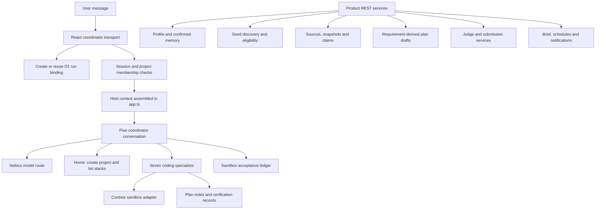

# Caddie AI system audit and walkthrough

Date: 2026-10-11
Repository: /Users/captjay98/projects/caddie-forge
Scope: AI behavior, context, tools, orchestration, discovery, build execution, approvals, verification, delivery and ongoing monitoring. UI work is paused.

## Verdict

Caddie has a working conversation transport, a configured Nebius provider, seven Flue specialist definitions, and substantial product services. It does not currently deliver the connected discovery-first AI workflow promised by onboarding. The primary defect is integration: backend functionality is frequently implemented without a corresponding agent tool or context connection. Several execution safeguards also validate records rather than independently verifying their origin.

The user's transcript is consistent with the source inspected: the Home coordinator receives project summaries, no profile or confirmed personal memory, no discovery tool, and a coding-oriented identity. This explains the responses much more directly than an unmeasured claim about model intelligence. Exact provider-request contents were not captured in this audit.

No application code, database, credentials, or UI was changed. No paid provider/sandbox calls or external effects were performed. The only repository addition is this report. Existing WIP was preserved.

## 1. The actual AI request path



The missing connection is from coordinator context/tools to those product services. Having a mounted REST endpoint does not make it available to the model.

### Conversation transport and identity

- `apps/app/src/client/coordinator.ts:45-85`: creates a run lazily on first send, reuses its conversation ID, and sends an idempotency key through the Flue SDK.
- `apps/app/src/server/routes/runs.ts`: checks authentication and membership for coordinator conversation access.
- `apps/app/src/app.ts:108-127`: resolves the run, builds host context, then forwards to the generated Flue router.
- Flue conversation state and application D1 records are separate persistence layers.

These are useful foundations. They do not automatically supply personal context, add tools, enforce spending limits, or prove a completed build.

### Model and runtime

`apps/app/src/agents/providers.ts` registers Nebius Token Factory with compatibility settings for its OpenAI-compatible API. The coordinator and client select `nemotron-3-super`; the configured model identifier is `nvidia/nemotron-3-super-120b-a12b`. All seven specialists inherit the coordinator model. They are role-specific agents, not seven independently selected models.

The registry also configures pricing, context and response limits. Those are application configuration values, not independently verified current provider specifications or prices in this audit. Do not infer billing enforcement from the existence of these fields.

**Recommendation:** keep the selected framework while closing integration gaps. A model/framework replacement is not supported by the evidence gathered. Evaluate model quality after giving the model the intended context, capabilities and measurable tasks.

## 2. Profile and memory: stored, but unavailable to chat

The current profile service stores country, timezone, weekly hours, experience, preferred stacks, interests, attendance format, skills, a previous project highlight and budget preferences. Those newer fields round-trip in the focused local suite.

`apps/app/src/server/memory.ts:478` exposes `memoryForInjection`: confirmed personal facts plus authorized project facts, excluding proposed and retracted facts. Its production caller is the `/api/memory/injection` REST endpoint in `server/routes/profile.ts:138`. The coordinator does not call it.

The actual Home context is only a project overview:

```ts
// apps/app/src/app.ts:180
const projects = await listProjectsForActor(env.DB, scope.actorId);
// Home host context includes homeOverview, createProject and listStacks.
// It does not load getProfile() or memoryForInjection().
```

**Effect:** collecting onboarding information does not currently personalize the model. “I know nothing about you” is incorrect at product level, but consistent with the context supplied to this agent.

**Required change:** assemble a bounded, server-authenticated context containing profile, confirmed memory, available capabilities and relevant current project state. Distinguish user-confirmed facts from agent proposals. Add scoped profile/memory read tools and a proposal tool; never let a model silently confirm its own inference. Corrections/retractions must disappear from later turns, including after reload/restart. Profile budget preferences must remain separate from spending authorization.

## 3. Identity and Home capabilities

`agents/coordinator.ts:242-258` calls Caddie a coding coordinator and tells it to delegate to coding specialists. No instruction makes hackathon discovery its first responsibility. Home instructions say no delegation/build plan applies, while the generic instructions still tell it to work through specialists. All specialists and the acceptance tool are registered even on Home, where sandbox and plan operations are deliberately refused.

**Effect:** capabilities are advertised too broadly, while the actual primary capability is absent. The response about product/frontend/backend/mobile/QA follows the implemented identity.

**Required change:** provide one discovery-first identity and an authoritative capability registry. Mount tools appropriate to the current context. Home should be able to discover, explain matches, inspect rules, save/select opportunities, discuss ideas and create projects. Build tools should appear in an authorized project build context. The reply must distinguish enabled capabilities from unavailable integration prerequisites and planned work.

## 4. Discovery and personal fit

`server/routes/discovery.ts:124-126` runs only:

```ts
adapters: [createLocalSeedAdapter(c.env.DB)]
```

The feed service has a useful adapter seam, stable candidate identity, deduplication and visible source failures. The mounted adapter reads local D1 seeds. It does not fetch current hackathons. No discovery tool is mounted on the coordinator.

Profile matching is also incomplete:

```ts
// server/routes/discovery.ts:115
return { country: profile?.country ?? null };

// server/discovery.ts:652
void candidate;
const all = await listClaims(db, scope);
```

- Eligibility receives country only.
- Candidate eligibility ignores the candidate and reads all active project eligibility claims. Multiple events in one project can consequently be evaluated against the same combined rules, rather than each event's own rules.
- `computeFit` counts requirements backed by reconciled project claims. It does not score the builder's interests, skills, time, attendance preference or budget.
- A supported claim type is evidence coverage, not proof that a user is suited to the event or that a requirement has been satisfied.

**Required change:** connect approved real sources, store event-specific provenance and rule links, and keep hard eligibility separate from personal fit. Apply solo eligibility; do not introduce a team-mode onboarding requirement. Use country, online/in-person preference, interests, skills, hours/deadline runway and resource preferences for explainable suitability. Unsupported eligibility rules should stay unknown and prompt a targeted question. Show source URLs, capture times and specific reasons for each match. Source selection/credentials may gate real retrieval, but deterministic matching and multi-event isolation can be implemented and tested locally now.

## 5. Rules and evidence

`server/evidence/` already implements source registration, immutable snapshots, claims, authority reconciliation, retained conflicts and deadline normalization. `captureFromUrl` exists behind an outbound-fetch authorization policy; private network restrictions are part of that policy. This is more nuanced than saying the entire application has no retrieval capability.

However, the coordinator has no tools to register/read/capture sources, extract claims or assess rules. The inspected runtime path does not automatically turn a selected event page into structured rule evidence. Claim storage accepts structured input; that is not an implemented autonomous extraction pipeline.

**Required change:** connect safe retrieval, structured rule extraction and validation to source snapshots. Treat retrieved content as untrusted data. Preserve quotes and provenance; do not let a web page give the agent instructions. Surface uncertainty and conflicting rules. Re-check evidence before consequential planning or submission decisions.

## 6. Planning

`server/planning.ts` explicitly generates deterministic requirement-derived kernel/scope/PRD/spec drafts. It preserves user revisions and links milestones to cited deadline claims. This service does not call a model.

The product/tech-lead specialists can append plan notes, but their project-context reader reads only requested plan-document kinds. They lack a direct read of personal constraints, opportunity evidence, eligibility or a comprehensive project brief. Home cannot write a plan.

Plan writes in `app.ts:380-382` append a document but do not advance the run binding's plan revision or invalidate acceptance evidence through that path. The current revision cache is populated from the binding. A new document and the run's gate revision can therefore drift apart.

**Required change:** connect accepted opportunity + user constraints + project idea to an AI planning step, then persist typed requirements, scope, milestones and plan revisions. Establish one current revision identity shared by plans, approval intents, sandbox verification and artifacts. Require an explicit human plan decision before implementing against it; enforce that decision in execution, not just prompt text.

## 7. Specialists and skills

| Role | Current tool boundary | Main missing integration |
|---|---|---|
| Product | Read plan notes; append plan notes | Builder profile, event rules and accepted brief |
| Designer | Product tools plus sandbox reads | Complete design/interaction inputs; Home has no sandbox |
| Tech lead | Plan notes; sandbox execution/read/write; repair ledger | Actual controlled repair dispatch and pause enforcement |
| Frontend | Plan-note reads; sandbox execution/read/write | Selected stack discipline and complete accepted context |
| Backend | Same tool set as frontend | Same integration gap |
| Mobile | Same tool set as frontend/backend | Flutter skill/recipe activation and supported mobile workflow |
| QA | Plan-note reads; sandbox execution/read; verification records | Truly read-only product boundary and trusted execution receipts |

Specialists are real Flue declarations (`agents/specialists.ts:58-64`); the issue is depth and connectivity. Their instructions are brief and generic. Instructions alone cannot supply unavailable facts or call absent product APIs.

`agents/skills.ts:25-30` packages planning, build-verify, delivery-checklist and submission. Role assignments use planning/build-verify/submission; delivery-checklist is not assigned in the inspected registry. Stack-specific skill files exist for TanStack Start, Laravel/Inertia, FastAPI/React and Flutter, but are not imported into this registry or activated by the selected stack in this runtime.

`server/stacks.ts` lists React/Hono enabled and the other four planned. `server/runs.ts:93` binds runs to React/Hono. Templates or standalone stack acceptance scripts do not make those stacks selectable in the product agent loop.

**Required change:** retain the role structure, enrich only relevant context and skills, and explicitly select/load a stack recipe. Mount a discovery/rules capability first; a new specialist is optional, while tools and scope are necessary. Avoid adding agent titles as a substitute for making existing agents effective.

## 8. Build execution, repairs and recovery

The Contree adapter is an actual REST-backed sandbox driver with command/file operations, image snapshots, output/upload/time quotas and cancellation/reconciliation concepts.

The production host creates it with:

```ts
// apps/app/src/app.ts:263
new InMemorySandboxPersistence()
```

This instance is created inside the request context builder. Remote image/session/operation bindings are not durably restored by this host path. The adapter's recovery design depends on a persistence port, but the production wiring uses memory. Even another request can construct a new store; a Worker restart certainly cannot recover the previous store.

The build path creates a workspace directory, but does not connect the selected template or imported repository snapshot to sandbox hydration. A functioning sandbox is not evidence that a fresh project or imported repo is ready for specialists.

`delegate_repair` takes role/task, but the host callback only records a started repair round. It does not use role/task to dispatch the repair. The three-failed-attempt policy is a service verdict; the inspected agent dispatch path does not check that verdict before further tool execution or reliably record repair outcomes through the delegation callback.

**Required change:** durable run-bound sandbox persistence; hydrate the selected template/import; record real operation identities/results; reconcile ambiguous dispatch; carry cancellation; enforce repair limits in execution; checkpoint successful revisions; verify recovery with the same run after restart. Keep legitimate re-execution after a code change distinct from retrying one operation.

A separate concern is `agents/coordinator.ts:54-112`: mutable module-global host context is replaced per request and read again in later hooks/tool callbacks. Request/conversation isolation needs investigation and a concurrent two-user/two-project test. This audit did not demonstrate a cross-user leak.

## 9. Verification and acceptance: confirmed trust defect

The coordinator tool accepts model-provided command, exit code, digest and operation key. It checks revision consistency, but does not look up an actual execution receipt before writing the gate ledger.

```ts
// agents/tools.ts:306-313
const record: GateRecord = {
  check: ctx.data.check,
  command: ctx.data.command,
  exitCode: ctx.data.exitCode,
  outputDigest: ctx.data.outputDigest,
  operationKey: ctx.data.operationKey,
  planRevision: ctx.data.planRevision,
  recordedAt: new Date().toISOString(),
};
```

The evaluator requires a key-shaped string and passing records. It does not require the full mandatory acceptance manifest or authenticate the key against command execution.

**LOCAL VERIFIED negative reproduction:** using the real tool/evaluator with an isolated in-memory sandbox stub, zero executed commands, command `never-executed-command`, digest `invented`, key `invented-key` and the current revision:

```json
{
  "executedCommands": 0,
  "record": {"output": "acceptance recorded for audit-synthetic (exit 0)"},
  "gate": {"completable": true}
}
```

This proves the application gate can accept fabricated evidence. It does not prove that the user's model has already fabricated a result.

Other confirmed boundary shortcomings:

- `sandbox_exec` returns only a dispatched remote ID, discarding the adapter's exit/output in this tool result. Native Flue sandbox execution is a separate surface; both should converge on one trusted evidence record.
- QA has arbitrary shell execution. Omitting `write_sandbox_file` does not prevent QA from changing source files using shell commands.
- The protected-path checker is raw prefix matching; `./tests/acceptance/manifest.json` is not blocked by `isProtectedPath`.
- Command protection is substring matching; `cd tests && touch acceptance/audit-marker` is not detected. This command was only passed to the predicate, never executed.
- D1 QA verification records also accept caller-provided pass/fail/evidence, and an authenticated REST endpoint can append them. Treat them as declarations unless backed by trusted receipts.
- Judge/submission access labels derive from those verification records; a textual `deployed:` prefix alone is not authenticated proof of deployment.

**Required change:** the executor owns command receipts. Acceptance references a receipt ID and checks actor/project/run, plan revision, actual exit/output, code or image identity, and the complete required check set. Isolate acceptance tests from agent writes and make QA's environment genuinely read-only where required. Normalize file paths; do not treat string scans as a secure filesystem permission boundary. Enforce trusted evidence consistently in build, judge and submission services.

## 10. Approvals and costs

Approval services and authenticated decision routes exist. GitHub default-branch delivery calls the durable approval checker at effect time. That is a useful boundary to preserve.

However:

- `request_approval` is mounted only when the host supplies `requestApproval`.
- Neither Home nor build context returned by `app.ts` supplies it.
- Its instructions refer to `read_approval`, which is not mounted.
- The current build/sandbox path does not require an approved plan before executing.
- `reserveBudget`, `settleReservation` and `releaseReservation` exist only as definitions in production source; the coordinator/provider/run path does not call them.
- Freezing a payer/model/pricing binding does not reserve or settle real costs. A budget preference or approval card amount is not a financial control.

**Required change:** connect scoped approval request/read/suspend/resume to the coordinator; validate approval at effect time. Integrate budget authorization, atomic reservation, usage accounting and settlement/release with actual model and sandbox execution. Define exactly which costs Caddie must ask about and which are already covered by platform/user authorization. Rejected, stale, revoked and exhausted states must stop execution independently of model cooperation.

## 11. Delivery, judge, submission and ongoing assistance

- **Artifacts/previews:** real storage, revision and token/access services exist. No explicit coordinator tools publish their actual build outputs through these services. Join build receipts to artifacts/previews; do not assume a sandbox file automatically becomes an app preview.
- **Existing repositories:** GitHub installation/import and patch/PR delivery services exist. The agent tool set does not expose them or hydrate an imported snapshot into its sandbox. Connect the full import/read/change/verify/review/deliver path and retain scoped external-effect gates.
- **Judge:** evidence-derived rubric extraction and structured scorecard validation exist. Scoring submission accepts a structured result; the coordinator has no connected judge tool. Evidence-to-criterion matching uses token overlap, which is a coarse heuristic, not a substantive evaluation. Add a model-assisted assessment against actual artifacts and rubric, while preserving validated citations and trusted proof levels.
- **Submission:** cited checklists, export version/hash, reuse disclosure and separate human external-submission confirmation exist. The coordinator cannot orchestrate these services. Preserve human submission as the explicit product decision; make preparation available conversationally.
- **Brief:** reads stored approvals, conflicts, stale artifacts, failed rounds and schedules. Its quality depends on accurate runtime records; it is not itself an autonomous agent.
- **Schedules/Sentinel:** the Worker has a real scheduled handler. Sentinel compares already-stored snapshots. It does not fetch/extract fresh rules on a tick. A scheduled run payload records a started ledger round rather than resuming an AI job. Close those execution gaps before promising background discovery, monitoring or proactive work.
- **Notifications:** services exist, but delivering a notification is distinct from having performed the underlying AI task.

## 12. What the evidence actually proves

### Focused local suite

```sh
bun test tests/agent-permissions.test.ts tests/home-chat-tools.test.ts \
  tests/discovery.test.ts tests/judge.test.ts tests/sentinel.test.ts \
  tests/profile-preferences.test.ts
```

Result: **83 pass, 0 fail, 408 assertions**. No paid calls. These prove useful component behavior, not the complete product journey. Notably, the QA test classifies write ability by tool names and does not test arbitrary-shell mutations.

### Acceptance reproduction

Real `makeRecordAcceptance` and `evaluateGateLedger`, in-memory harness only: fabricated passing record accepted, gate completable. Protected path/command predicates returned false for the examples above. No protected files or commands were executed.

### Misleading lifecycle test

The complete body of `tests/live/flue-lifecycle.spec.ts:18-30` only checks `CADDIE_LIVE_AUTHORIZED === '1'`. It does not contact Nebius, verify credentials, send a Flue message, test tool execution, restart a Durable Object, or test reconnect/idempotency.

```sh
env -u NEBIUS_API_KEY CADDIE_LIVE_AUTHORIZED=1 \
  bun test tests/live/flue-lifecycle.spec.ts
```

Result: **1 pass, 0 fail**, with the key removed and no provider request. This is an authorization-precondition test, not live lifecycle evidence.

`scripts/run-journey.ts:31-33` explicitly excludes the model-driven coordinator loop. It builds/tests a seeded fixture and performs a scripted repair. This is useful infrastructure proof, but does not prove Caddie independently plans, delegates, builds and repairs a user's application. Some execution-ledger descriptions characterize these suites more broadly than their current source supports. Reconcile those claims; prior manual live chat evidence can still prove streaming/model access without proving the missing lifecycle behaviors.

No fresh live model/sandbox journey, deployed acceptance or exact provider-request trace was obtained in this audit. The pasted user conversation demonstrates a real behavioral failure; source and local reproductions explain specific causes.

## 13. Repair order and concrete acceptance

1. **Close the personal assistant gap.** Server-derived profile and confirmed memory, discovery-first identity, appropriate capability tools. Acceptance: after onboarding/reload, “what do you know about me?” accurately names saved preferences, separates unknowns, and respects corrections/retractions. A second user's private facts never appear.
2. **Close discovery and rule isolation.** Real source adapter plus event-specific snapshots/claims, full profile suitability and solo filtering. Acceptance: asking for hackathons invokes a real discovery tool; recommendations cite current sources and specific fit reasons; different events' restrictions cannot contaminate one another. Source failures and unsupported rules remain visible.
3. **Repair execution trust and spending before extending autonomy.** Executor-owned receipts, mandatory manifest checks, approval bridge/effect gates, budget reservation/settlement. Acceptance: fabricated receipt rejected; missing checks block completion; rejected/revoked/stale approval and exhausted budget prevent effect; QA cannot mutate protected checks/product through any tool surface. Build against one accepted revision.
4. **Prove one complete React/Hono journey.** Brief → AI plan → human approval → template/import hydration → specialist implementation → real tests → bounded repair → preview/artifact → judge/submission preparation. Acceptance: one new, non-seeded project completes the real conversational workflow; deliberate failure triggers real repair; restart resumes the same sandbox/run; evidence is bound to final code. Record live authorization and actual receipts separately.
5. **Connect background work and broaden stacks.** Fresh rule retrieval on schedule, actual AI dispatch/resume, meaningful Brief updates, then stack recipe/skill activation and independently proven journeys for the other agreed stacks. This is sequencing, not removal from the agreed scope.

Keep code simple by having one context assembler, one typed capability/tool boundary over existing services, one durable execution/evidence path, and one explicit run state/revision authority. The framework should orchestrate those components; it should not be expected to invent the connections. Stop treating a mounted API, skill file, green fixture suite or completion-ledger entry as proof of an enabled end-user capability.
